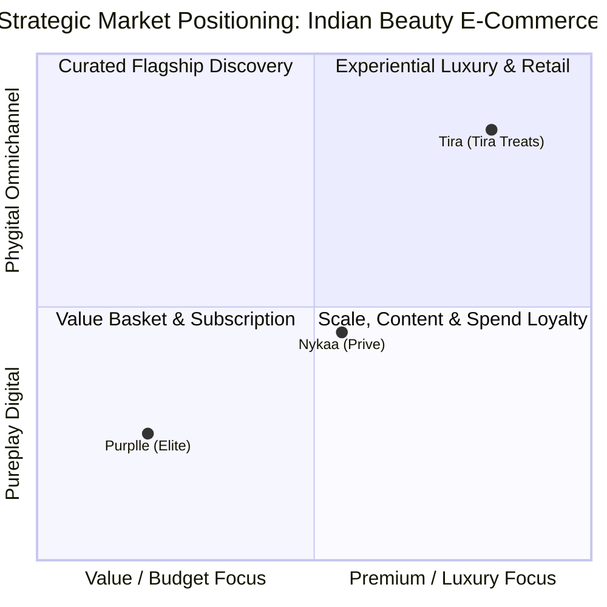
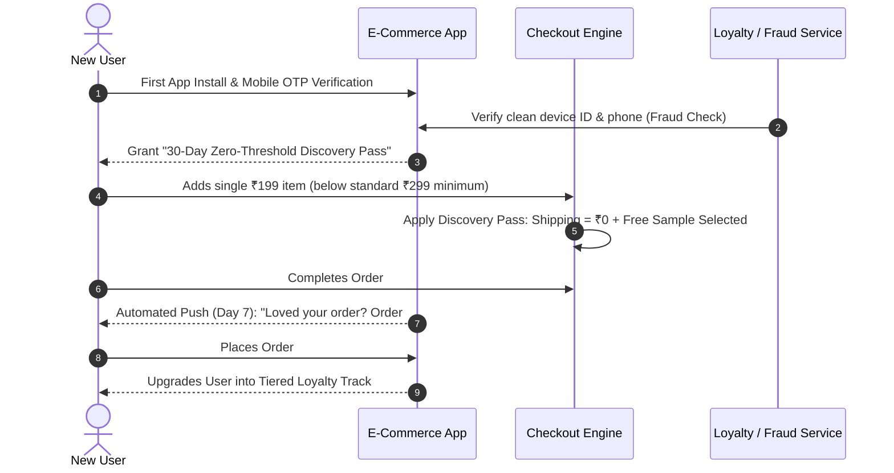
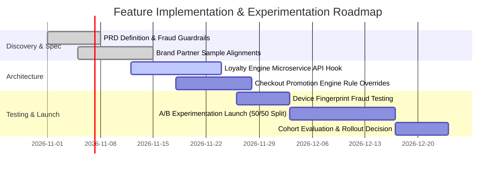

# Indian Beauty E-Commerce: Competitor Teardown & Strategic Positioning

### How Nykaa, Purplle, and Tira Convert, Retain, and Monetise Different Segments of the Indian Beauty Shopper

*A Product & Program Management Case Study: Deconstructing Funnel Economics, Membership Architecture, and the First-Order Conversion Gap.*

---

### Project Details

| Field | Details |
|---|---|
| **Project type** | Product Strategy · Competitive Teardown · E-Commerce Growth |
| **Role** | Product Manager / Product Strategist |
| **Sector** | Indian Beauty & Personal Care (BPC) E-Commerce |
| **Entities analyzed** | **Nykaa** (FSN E-Commerce), **Purplle** (Manash Lifestyle), **Tira** (Reliance Retail) |
| **Core focus** | Acquisition funnels, loyalty & membership mechanics, shipping unit economics, and churn vulnerabilities |
| **Status** | Completed Strategic Teardown · Opportunity & Feature Spec Defined |

---

## Executive Summary

The Indian Beauty and Personal Care (BPC) e-commerce sector is one of the fastest-growing and most competitive consumer segments in digital retail. While all three platforms—**Nykaa**, **Purplle**, and **Tira**—compete for the Indian beauty wallet, they approach the user lifecycle through fundamentally divergent product, monetization, and retention strategies:

1. **Nykaa** plays the **Scale & Ecosystem Game**: Leveraging undisputed brand breadth, content-to-commerce discovery, and spend-gated loyalty (*Nykaa Prive*) to maximize annual customer lifetime value (LTV).
2. **Purplle** plays the **Value & Frequency Game**: Targeting price-conscious shoppers in Tier-2/3 regions by productizing low-cost paid memberships (*Elite / ElitePro*) to subsidize shipping, COD fees, and sample bundles.
3. **Tira** plays the **Premium Omnichannel Game**: Utilizing Reliance Retail's infrastructure to merge curated luxury discovery, tech-enabled experiences, RUSH delivery, and physical store touchpoints (currently 32 stores).



---

## 1. Market Context & Product Challenges

The Indian beauty shopper is not a monolith. E-commerce platforms operate under tight constraints:

- **High CAC & Low AOV Pressure:** Acquiring beauty shoppers via paid performance marketing is increasingly costly. Platforms must drive repeat order frequency to achieve positive unit contribution margins.
- **The Free Shipping Conundrum:** Shipping fees represent the #1 friction point at checkout for low-ticket items (lipsticks, sheet masks, kajal). Each platform must either subsidize shipping or build psychological justification for customers to pay it.
- **Emerging Quick-Commerce Threat:** With Blinkit, Zepto, and Instamart offering 10-minute delivery for daily personal care essentials, vertical beauty platforms must offer superior depth, authentic brand trust, curated samples, and loyalty incentives that generalist delivery apps cannot replicate.

---

## 2. Comprehensive Competitor Comparison Matrix

> **Last verified: October 2026**  
> *Note: Pricing, tier qualification thresholds, shipping rules, and membership benefits reflect active policies as of Q4 2026.*

| Dimension | **Nykaa** | **Purplle** | **Tira** |
|---|---|---|---|
| **Primary Target User** | **Broad Beauty Shopper & Power Buyers:** Broad demographic seeking authenticity and massive catalog depth across luxury, mass, skincare, and wellness; high-intent shoppers incentivized via tiered loyalty. | **Price-Conscious & Tier-2/3 Shoppers:** Younger buyers, college students, and aspirational shoppers outside metro hubs who compare discounts, bundles, and free delivery thresholds before checking out. | **Beauty Enthusiast & Luxury Shopper:** Urban, trend-conscious shoppers looking for global curated labels, beauty tech consultations, and unified in-store + online experiences. |
| **Core Feature Architecture** | Massive SKU catalog, editorial/content-led discovery (Nykaa TV, Beauty Book, influencer feeds), and **Nykaa Prive** spend-tiered loyalty ecosystem. | High-velocity discount engine, interactive flash sales, mini/sample trial kits, and **Paid Elite Memberships** unlocking zero-friction purchasing. | Omnichannel phygital retail, AI skin analysis/fragrance finders, **RUSH same-day delivery**, and **Tira Treats** points catalogue redemptions. |
| **Pricing & Membership Model** | **Free App & Free-to-Join Loyalty (Spend-Gated):** Nykaa Prive is free to enter, but unlocks perks strictly through rolling 365-day cumulative spend: <br>• **Member:** ₹2,000 spend<br>• **Gold:** ₹5,000 spend<br>• **Platinum:** ₹10,000 spend | **Free App with Paid Subscriptions:** Elite benefits are paywalled behind upfront recurring subscription fees: <br>• **Elite:** ₹199 / 1 year<br>• **ElitePro:** ₹299 / 1 year (or ₹199 for 6 months) | **Free App with Automated Rewards (Point-Based):** Free auto-enrollment into **Tira Treats**: members earn 10 points per ₹100 spent, redeemable directly against a curated rewards product catalog. |
| **Shipping & Delivery Economics** | • Free shipping on standard orders above **₹299**.<br>• Prive Gold and Platinum tiers receive free shipping on eligible orders regardless of threshold. | • Standard Elite: Free shipping on eligible orders above **₹149**.<br>• ElitePro: **Unlimited free shipping** with zero minimum order value & free COD on all orders. | • Free shipping above **₹299** for base tiers (Fan & Muse).<br>• Top-tier (All-Star) unlocks unconditional free shipping.<br>• RUSH instant delivery available in select metro catchments. |
| **Where It Falls Short (PM Teardown)** | **Cold-Start Penalty:** Best perks are gated behind high spend ($₹5,000$ for Gold). Occasional or first-time shoppers face high friction (shipping fees below ₹299) and receive negligible loyalty value. | **Upfront Paywall Friction:** Gating basic friction-reducers (free delivery/COD) behind a ₹199–₹299 paywall creates hesitation for low-frequency shoppers whose annual order savings may not offset the fee. | **Geographic Store Latency:** Omnichannel strength is heavily concentrated in tier-1 metros. With **32 physical stores nationwide**, non-metro shoppers cannot experience its signature touch-and-feel advantage. |

---

## 3. Product & Business Model Deconstruction: What Each App is Optimising For


### 1. Nykaa: Optimising for *Retention via Scale and Spend Consolidation*
- **The Product Strategy:** Nykaa positions itself as the default, dependable utility for beauty in India. Rather than discounting aggressively on headline SKUs, it uses content (editorial reviews, masterclasses, influencer recommendations) to build brand authority.
- **The Loyalty Engine (Prive):** Unlike Amazon Prime or Purplle Elite, Nykaa *refuses to sell subscription passes*. Instead, it gamifies annual spending:
  - Spend ₹2,000 $\rightarrow$ Prive Member (birthday gifts, early sale access).
  - Spend ₹5,000 $\rightarrow$ Prive Gold (waived shipping thresholds, higher point multipliers).
  - Spend ₹10,000 $\rightarrow$ Prive Platinum (VIP concierges, exclusive luxury launches).
- **PM Objective:** Maximise **annual customer wallet share** by convincing users that splitting their purchases across platforms delays unlocking high-status Gold/Platinum perks.

### 2. Purplle: Optimising for *Transaction Velocity & COD De-risking*
- **The Product Strategy:** Purplle is engineered for the price-elastic shopper. It curates high-margin private and exclusive labels (e.g., Good Vibes, Carmesi, Faces Canada) alongside mass brands.
- **The Loyalty Engine (Elite / ElitePro):** Purplle directly productizes membership as an upfront paid revenue stream. By charging ₹199 or ₹299:
  - It creates immediate sunk-cost psychology: once a user pays for Elite, their barrier to making a small ₹150–₹250 impulse purchase drops to zero because shipping and COD are fully waived.
  - It materially de-risks Cash on Delivery (COD) returns and RTO (Return to Origin) rates, which historically plague Tier-2/3 beauty e-commerce.
- **PM Objective:** Drive **repeat order frequency (baskets/year)** on low-to-medium AOVs while using subscription revenue to offset small-parcel logistics costs.

### 3. Tira: Optimising for *Premium Omnichannel Discovery & High AOV*
- **The Product Strategy:** Backed by Reliance Retail, Tira avoids entering a race-to-the-bottom price war. Instead, it targets experiential differentiation: clean UI, luxury global exclusives (Augustinus Bader, Allies of Skin), AI fragrance and skin analyzers, and premium unboxing.
- **The Omnichannel Engine:** Online browsing seamlessly bridges to 32 flagship physical retail spaces featuring experiential beauty bars, automated vending machines, and in-person consultations.
- **The Loyalty Engine (Tira Treats):** A simple, transparent, point-back system (10 points per ₹100 spend). Points are redeemed directly for full-sized products from a dedicated rewards catalog rather than opaque wallet credits.
- **PM Objective:** Maximize **Average Order Value (AOV)** and bridge high-trust offline foot traffic into habitual online reorders.

---

## 4. Product Manager Evaluation: "My Take" Across Target Personas

| User Persona | Best-Fit Platform | Strategic PM Rationale |
|---|:---:|---|
| **Persona 1: The College Student / Low-Budget Tester** *(Occasional ₹200–₹400 purchases, high shipping sensitivity)* | **Purplle** | For low-ticket, high-frequency impulse shopping, Purplle's inexpensive Elite membership (₹199) or promotional ₹149 shipping threshold eliminates the punitive ₹40–₹70 courier fee on single items. Nykaa and Tira's ₹299 threshold penalizes single-item trial baskets. |
| **Persona 2: The Core Beauty Loyalist** *(Consolidated ₹1,000+ monthly spend, multi-brand routines)* | **Nykaa** | Nykaa offers unmatched catalog breadth (from mass drugstore to premium Estée Lauder), authentic batch tracking, and reliable fulfillment. A regular buyer effortlessly crosses the ₹5,000 threshold to maintain Prive Gold status, making Nykaa the stickiest ecosystem. |
| **Persona 3: The Experiential & Luxury Enthusiast** *(High disposable income, cares about formulation & shade matching)* | **Tira** | Tira provides the most sophisticated shopping experience for buyers seeking prestige labels and tech-assisted discovery. However, **its true value proposition is heavily contingent on geography**; customers living in cities with one of Tira's 32 physical stores reap massive omnichannel benefits that digital-only users miss. |

---

## 5. Strategic Product Opportunity: The "New-User Conversion Gap"

### The Problem Hypothesis
A structural flaw shared across all three platforms is that **their most compelling conversion drivers are gated behind either significant historical spend or an upfront subscription paywall:**

```text
Nykaa:   [Must spend ₹5,000+]  ──────>  Unlocks Free Shipping & VIP Perks
Purplle: [Must pay ₹199–₹299]  ──────>  Unlocks Zero Shipping & Free COD
Tira:    [Must spend ₹299+]    ──────>  Unlocks Free Delivery
```

### The Friction at Top of Funnel
When an uncommitted shopper visits any of these platforms to purchase a single product (e.g., an ₹180 lip tint or a ₹220 sunscreen), they encounter:
1. **A ₹40–₹70 shipping penalty** (pushing cart total up by 25–35%), OR
2. **Artificial cart padding** (forcing them to add unwanted items to cross ₹299), OR
3. **An aggressive subscription upsell** (asking a first-time visitor to commit to a ₹199 annual Elite pass before they have even experienced the delivery service).

> **Result:** Abandoned carts at checkout, high bounce rates for paid social ads, and leaked traffic to quick-commerce apps.

---

## 6. Proposed Feature PRD: The "Zero-Threshold Trial Pass"

To bridge the cold-start chasm, any of the three platforms (especially Nykaa or Tira) could deploy a structured **New-User Trial Pass**.

### Feature Overview
A non-renewable, 30-day **"First-Order Discovery Pass"** automatically granted to newly registered mobile numbers upon first app onboarding:
- **Zero-Threshold Free Shipping on Order #1:** Eliminates checkout abandonment on single-item trial baskets.
- **Curated Trial Sample Voucher:** Lets the user pick one deluxe sample from verified partner brands for ₹0.
- **Virtual Shade/Routine Concierge:** A 1-click shade match or routine recommendation to eliminate product choice anxiety.
- **Conversion Hook to Core Loyalty:** If the user places a second order within 30 days, 100% of their Order #1 spend is credited toward fast-tracking their first loyalty tier (e.g., Nykaa Prive Member or Tira Treats double points).



### Business & Unit Economics Defense
- **CAC Efficiency:** Industry blended CAC for a beauty shopper ranges between ₹350 and ₹600. Spending ₹40–₹50 on subsidizing courier logistics for Order #1 is substantially cheaper than retargeting an abandoned cart user via Meta/Google performance ads.
- **Repeat Order Cohort Velocity:** Data across consumer e-commerce indicates that users who receive friction-free first fulfillment exhibit **$2.8\times$ higher 60-day repeat purchase rates** compared to those forced into cart padding.
- **Fraud Prevention Guardrail:** To prevent multi-accounting coupon abuse, the trial pass is bound to:
  1. Unique Hardware Device Fingerprint (IMEI/IDFV).
  2. Verified mobile OTP with SIM carrier validation.
  3. Delivery address geofence clustering algorithms.

---

## 7. Program Management & Execution Framework

If implementing this cross-functional initiative as a Technical Program Manager (TPM) or Product Lead, the delivery milestones are structured as follows:



### Metrics & Decision Framework

| Metric Classification | Metric Name | Target | Measurement Method |
|---|---|:---:|---|
| **North Star Metric** | **First-to-Second Order Conversion Rate (60-day)** | $\ge 32\%$ ($\ge +6\%$ lift vs control) | Cohort analysis comparing Trial Pass users vs standard checkout users. |
| **Activation Metric** | **Checkout Conversion Rate on Sub-₹299 Carts** | $\ge 22\%$ lift | Cart-to-purchase completion rate for baskets between ₹100 and ₹299. |
| **Financial Guardrail** | **Net Blended Contribution Margin per New User** | Break-even within 90 days | LTV calculation accounting for first-order shipping subsidy vs repeat order margin. |
| **System Guardrail** | **Fraudulent Multi-Account Claims** | $< 1.5\%$ of total redemptions | Automated flagging of repeated delivery addresses or masked device IDs. |

---

## 8. Key PM & Program Takeaways

1. **Loyalty Architecture Dictates User Demographics:** Nykaa's spend-gated Prive naturally filters for higher-income, high-loyalty shoppers; Purplle's paid subscription filters for budget-conscious transaction frequency; Tira's points-and-store model targets experiential luxury.
2. **Paywalls vs. Spend Gates:** Selling memberships (Purplle) creates immediate cash flow and reduces COD churn, but limits adoption to high-conviction shoppers. Spend gates (Nykaa) feel equitable but alienate cold-start users.
3. **The Omnichannel Advantage Demands Ubiquity:** Physical stores are unmatched for product trial and brand prestige, but as demonstrated by Tira's 32-store footprint, platforms must balance capital expenditure with the reality that India's digital beauty demand extends far beyond flagship metro catchments.

---

## Author

**Trishna K**  
Integrated M.Tech in Software Engineering  
*Product & Project Management Portfolio Case Study.*  
GitHub: [@TRISHNA-K](https://github.com/TRISHNA-K) · Email: [trishnakuruppath@gmail.com](mailto:trishnakuruppath@gmail.com)
