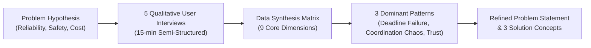
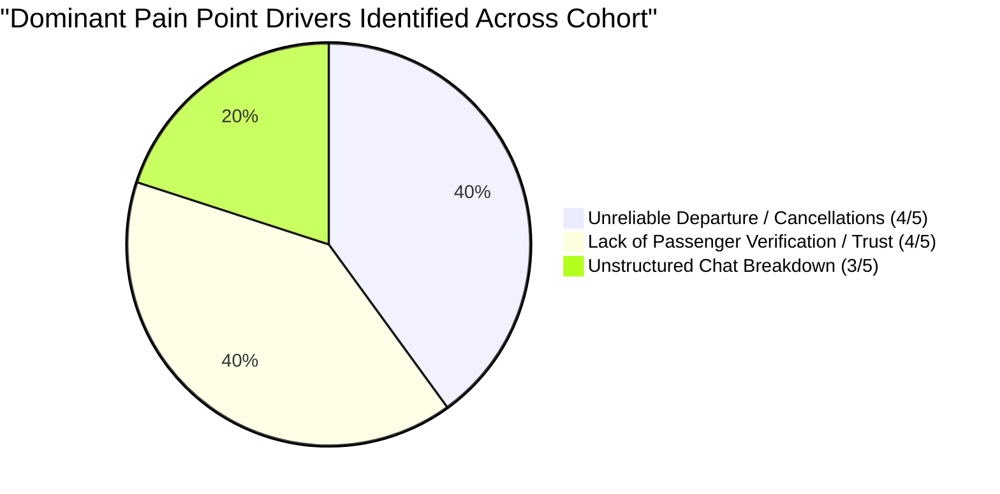
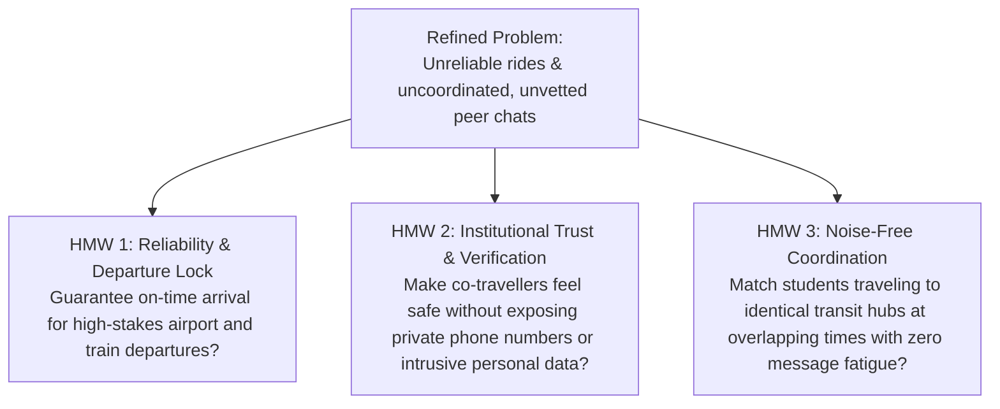
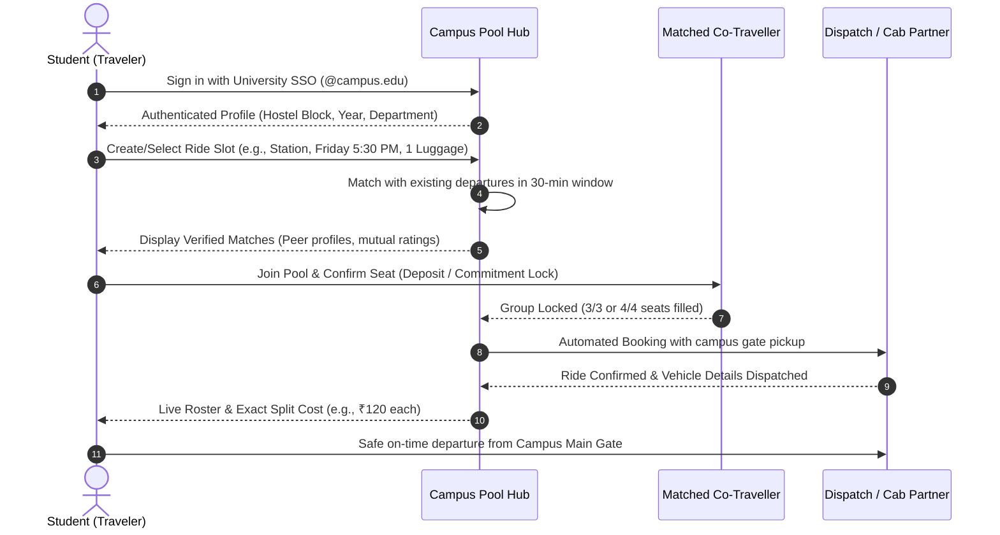

# Campus Ride-Sharing & Travel Reliability

### A User Research & Product Discovery Case Study on University Off-Campus Mobility

*A self-directed product discovery case study: uncovering student travel friction, validating the core problem hypothesis through 5 qualitative user interviews, and defining an evidence-based product direction.*

---

### Project Details

| Field | Details |
|---|---|
| **Project type** | Product Management · User Research & Problem Discovery |
| **Role** | Self-Directed Product Researcher / PM |
| **Context** | University campus travel (to the city center, railway station, airport, and home) |
| **Method** | 5 semi-structured 1-on-1 interviews (15 minutes each) |
| **Status** | Completed User Research & Problem Validation · Concept Stage (Prototyping Next) |
| **Target user** | On-campus university students needing predictable, safe, and coordinated off-campus transit |
| **Key outcome** | Hypothesis refinement, behavioral pattern synthesis, and 3 validated solution concepts |

---

## Executive Summary

University students living on campus frequently need to travel off campus for weekend trips home, train and flight departures, academic visits, or social outings. While students frequently complain about taxi fares, preliminary research revealed that **the core barrier is not simply affordability—it is the catastrophic failure of ride reliability at high-stakes moments and the lack of verified trust when coordinating shared rides.**

Through 5 targeted, semi-structured interviews across distinct behavioral segments, this study uncovers how informal coordination channels (such as 300+ member WhatsApp hostel groups) collapse when students need them most, driving anxiety, missed connections, and inflated last-minute expenditures.



---

## 1. Problem Hypothesis & Research Framing

### The Initial Hypothesis

> *"Students who travel off campus struggle to find rides that are reliable, affordable, and feel safe."*

On suburban or self-contained university campuses, public transit connectivity is often limited, irregular, or far from hostel gates. Students depend primarily on auto-rickshaws, app-based cabs (Uber/Ola), or informal carpools. 

However, whether students prioritize price over punctuality, or whether safety concerns deter ride-sharing altogether, remained unverified.

### Research Questions

To test the hypothesis and uncover student behaviors, the study focused on four foundational inquiry areas:

1. **Current Behaviors & Frequency:** How do students currently get off campus, how frequently do they travel, and what travel modes do they choose?
2. **Failure Modes & Coping Mechanisms:** What goes wrong during these trips, and what workarounds do students resort to when their plans break down?
3. **Safety & Affordability Perceptions:** What specific conditions make a trip feel safe or unsafe, and affordable or unaffordable?
4. **Behavioral Avoidance:** What travel options or situations do students actively avoid, and what are the underlying reasons?

---

## 2. Research Methodology & Participant Profiles

### Methodology Rationale
- **Format:** 1-on-1 semi-structured qualitative interviews (15 minutes each).
- **Why Qualitative:** At the discovery phase, quantitative surveys capture *what* people think they want (e.g., "cheaper cabs"), whereas qualitative interviews uncover *why* systems break down and reveal the emotional drivers behind real behavioral trade-offs.
- **Sampling Strategy:** Purposive convenience sampling across 5 distinct travel archetypes to examine extreme users, frequent riders, and resistant non-sharers.

### Participant Personas (Sample Archetypes)

| Participant | Travel Pattern | Context & Typical Destination | Rationale for Inclusion |
|:---:|---|---|---|
| **P1** | **Frequent City/Station Commuter** | Travels off-campus multiple times a week to the city center or local railway station. | Deeply familiar with everyday transit friction, pricing swings, and driver negotiations. |
| **P2** | **High-Stakes Long-Distance Traveler** | Travels to the international airport or long-distance rail terminals for semester breaks/internships. | Represents time-critical, high-stakes trips where a delayed or cancelled ride causes catastrophic loss (e.g., missed flights). |
| **P3** | **Regular Weekend Commuter** | Travels home almost every Friday evening, returning Sunday night. | Represents predictable, recurring travel with high potential for habit-based carpooling. |
| **P4** | **Shared-Ride Avoider** | Prefers solo cabs or family pick-ups; avoids carpooling with unfamiliar peers. | Critical extreme user to uncover real psychological barriers, safety thresholds, and trust requirements. |
| **P5** | **Group-Chat Power User** | Actively posts in hostel WhatsApp / Telegram ride-sharing groups. | Demonstrates the operational limits, communication breakdown, and failure rates of current community workarounds. |

---

## 3. Interview Notes & Cross-Participant Synthesis

Each 15-minute interview followed a structured guide covering recent trip experiences, expenditure, failure incidents, coordination attempts, safety boundaries, and prioritized desires.

### Synthesis Matrix

| Question Area | P1 (Frequent Commuter) | P2 (High-Stakes / Airport) | P3 (Weekend Commuter) | P4 (Ride Avoider) | P5 (Group-Chat User) |
|---|---|---|---|---|---|
| **Last trip** | Auto-rickshaw to railway station on a Saturday night. | Pre-booked cab to airport for a 7:00 AM flight. | Shared auto to bus stand on Friday evening. | Solo cab to a shopping mall with visiting family. | Cab to railway station arranged via hostel chat group. |
| **Cost & payment** | Paid more than expected; had to negotiate aggressively. | High price for a solo cab (paid surge premium). | Split three ways with peers; very affordable. | Paid full fare solo; felt expensive but "worth the peace." | Paid extra fare share after one person flaked. |
| **What went wrong** | App cab cancelled twice in a row; long, anxious wait. | Pre-booked cab cancelled at 4:00 AM; rebooked at double the price. | Auto did not arrive as agreed; nearly missed the outbound bus. | Nothing went wrong mechanically, but felt economically wasteful. | Messages got buried in chat; one student did not show up at hostel gate. |
| **What they did** | Frantically asked in hostel group for someone to split another cab. | Panic-booked a pricier emergency cab on another app. | Ran out to the main highway road and hitched a lift. | Booked solo ride; accepted the cost without question. | Remaining passengers paid the missing person's share to the driver. |
| **Shared rides: how arranged** | Posts in hostel WhatsApp group; often ignored or delayed. | Tried finding someone last-minute; nobody was on the same timeline. | Always the same 3 close hostel friends, arranged in person. | Does not share rides under any circumstances currently. | Large campus WhatsApp group with hundreds of daily messages. |
| **What they avoid** | Late-night trips alone outside the campus perimeter. | Early-morning departures without confirmed transport. | Unfamiliar co-travellers with unknown schedules. | Riding with strangers in an enclosed vehicle. | Sharing rides with people outside the verified student body. |
| **Safety & trust** | Feels unsafe waiting alone after dark outside campus gate. | Fine with licensed cab alone; uneasy sharing with unvetted strangers. | Feels completely safe only within an established friend circle. | Would consider sharing **only if verified** (university credentials). | Considers hostel group members "safe enough," but hates zero accountability. |
| **One thing they'd change** | Upfront fixed pricing without roadside haggling. | Guaranteed booking reliability with automated cost split. | A live schedule of who else from campus is heading out. | Verified passenger profiles showing department and hostel block. | A dedicated, structured roster of confirmed departures. |
| **Best quote** | *"I post in the hostel group every time, but half the time nobody replies."* | *"The cab cancelled at 4 a.m. and my flight was at 7."* | *"I only share with people I already know."* | *"I'd share if I knew who they were, even just their year and hostel."* | *"The group has 300 messages a day. Mine got buried."* |

---

## 4. Key Findings & Behavioral Patterns

Synthesis of the interview matrix revealed three primary behavioral patterns and two secondary observations:

### Pattern 1: Rides Fail at the Moments That Matter Most (4 of 5 Participants)

> **"The cab cancelled at 4 a.m. and my flight was at 7."** — *P2*

- **The Observation:** Participants P1, P2, P3, and P5 all recounted serious trip cancellations, driver no-shows, or ghost bookings during fixed-deadline departures (e.g., catching a train, bus, or flight).
- **Product Implication:** **The Reliability Paradox.** When departure stakes are high, price sensitivity plummets. Students care significantly less about finding the cheapest possible ride than about securing an ironclad ride that arrives on time.

### Pattern 2: Informal Ride-Sharing Channels Suffer from "Coordination Entropy" (3 of 5 Participants)

> **"The group has 300 messages a day. Mine got buried."** — *P5*

- **The Observation:** Students recognize the mutual economic benefit of carpooling, but rely on generic messaging channels (WhatsApp groups, Telegram channels, hostel broadcast chats). These groups suffer from message noise, lack of structure, rapid message displacement, and zero social accountability for no-shows.
- **Product Implication:** The demand to share rides exists in abundance, but **informal unstructured chat is the failure point.** A dedicated coordination mechanism with state management (open, filled, departed) is required.

### Pattern 3: Trust is a Prerequisite, Not an Add-On (4 of 5 Participants)

> **"I'd share if I knew who they were, even just their year and hostel."** — *P4*

- **The Observation:** Even P4, who actively avoids sharing cabs, explicitly noted an openness to carpooling if the co-travellers' identities could be verified. P2, P3, and P5 reinforced that campus affiliation (e.g., knowing their year, branch, and hostel residence) converts an "unsafe stranger" into an "acceptable peer."
- **Product Implication:** **Campus verification is the primary trust bridge.** Generic commercial carpooling fails on campus because it lacks institutional affinity. Showing institutional credentials provides sufficient psychological safety for students.



### Secondary Observations (< 3 of 5 Participants)
- **Time-of-Day Risk Perception:** Trips departing between 10:00 PM and 6:00 AM amplify vulnerability and anxiety, especially when waiting outside campus gates (P1, P2).
- **Price Haggling & Fare Uncertainty:** Off-meter auto-rickshaw bargaining creates cognitive frustration for students who lack local language fluency or negotiating confidence (P1, P4).

---

## 5. Hypothesis Evaluation

### Was the Problem Hypothesis Supported?

| Initial Hypothesis Dimension | Qualitative Evidence | Validation Verdict |
|---|---|:---:|
| **"Struggle to find rides that are reliable"** | 4/5 participants reported direct cancellations, no-shows, or frantic last-minute alternatives during time-sensitive journeys. | **STRONGLY VALIDATED** |
| **"Struggle to find rides that feel safe"** | 4/5 participants voiced distinct discomfort sharing rides with unverified strangers or waiting outside campus after dark; verified campus status resolved this concern. | **STRONGLY VALIDATED** |
| **"Struggle to find rides that are affordable"** | While participants acknowledged solo rides were expensive, they routinely overpaid or took pricier rides just to guarantee arriving on time. Cost is a secondary consideration behind punctuality and safety. | **PARTIALLY VALIDATED** (Secondary Priority) |

> **Conclusion:** The initial hypothesis was **partly accurate, but misweighted.** The true student hierarchy of needs for campus travel is:
> 
> $$\text{Reliability (Punctuality)} \ > \ \text{Safety (Verified Trust)} \ > \ \text{Affordability (Cost Split)}$$

---

## 6. Refined Problem Statement

Synthesizing the validated evidence yields the following refined problem statement:

> ### The Problem Statement
> **"University students traveling off-campus for fixed-time departures (trains, flights, weekend buses) struggle to secure dependable rides and trust-verified co-travellers, because existing solutions rely on cancellable commercial cabs and noisy, uncoordinated group chats with zero accountability."**

### User Needs & Jobs to Be Done (JTBD)

```text
When I have a scheduled departure off-campus (flight, train, or weekend trip),
I want to easily discover and lock in trusted campus peers heading to the same terminal,
So that I can split travel costs safely and guarantee that my ride will arrive without last-minute cancellations.
```

#### Core Functional & Emotional Jobs:
1. **Functional Job:** Reach the transit hub (airport/station) at least 45 minutes before departure without cancellation risk.
2. **Economic Job:** Reduce individual transit expenditure by dividing vehicle capacity (2 to 4 students per cab/auto).
3. **Safety / Emotional Job:** Ensure everyone in the vehicle is an authenticated university member to eliminate anxiety about personal safety.
4. **Coordination Job:** Eliminate the chaos of scrolling through hundreds of unorganized WhatsApp messages to find matching travel times.

---

## 7. Opportunity Mapping & "How Might We" (HMW)

From the refined problem statement, three high-leverage product opportunity spaces emerge:



1. **HMW 1 (Reliability):** *How might we guarantee ride commitment and on-time departure so students never risk missing a flight or train?*
2. **HMW 2 (Trust):** *How might we leverage campus identity (hostel, degree, year) to establish instant psychological safety between co-riders?*
3. **HMW 3 (Coordination):** *How might we replace unstructured chat noise with a structured, automated departure roster with transparent cost splitting?*

---

## 8. Solution Ideation & Concept Exploration

To address the findings, three product concepts were formulated and evaluated:

### Concept Comparison

| Evaluation Metric | Concept A: Campus Pool Board (P2P App / Web Hub) | Concept B: Scheduled Campus Shuttles (Charter Partnership) | Concept C: Trust-Gated WhatsApp / Telegram Bot |
|---|---|---|---|
| **Core Mechanism** | Dedicated campus web app with verified university SSO, departure slots, and group lock-in. | Scheduled fixed-window campus minivans for peak holiday/weekend departures. | Conversational bot inside existing chat apps managing structured departure rosters. |
| **Solves Reliability (4/5)** | **High:** Group lock prevents ghosting; automated booking confirmation with trusted local fleet. | **Very High:** Dedicated physical vehicle departing from campus gate on a fixed timetable. | **Moderate:** Relies on peers adhering to commitments without automated vehicle dispatch. |
| **Solves Trust (4/5)** | **Very High:** Verified university email SSO, displaying hostel block, degree, and graduation year. | **High:** Physical on-campus boarding with fellow verified students. | **Moderate:** Bot checks membership in authenticated university group, but metadata is sparse. |
| **Solves Coordination (3/5)** | **Very High:** Clean board sorted by destination (Airport, Station, City) and 30-min time buckets. | **High:** Pre-set departure schedule (e.g., Friday 4 PM, 6 PM; Sunday 8 PM). | **High:** Replaces freeform chat with structured forms and automated reminders. |
| **Implementation Effort** | Medium (Lightweight Next.js / Supabase web app with Google Campus SSO). | High (Requires transport vendor contracts, driver SLAs, campus administration approvals). | Low (Node.js / Python bot framework on Telegram or WhatsApp Business API). |

### Selected Direction: Concept A — "Campus Pool Hub"
Concept A provides the optimal balance of speed to prototype, structural scalability, and direct resolution of both the **Coordination Chaos** and **Trust Deficit** identified in research.

---

## 9. Proposed Experience Design: "Campus Pool Hub"

### User Journey Flow



### Key Screen Architecture

```text
┌────────────────────────────────────────────────────────┐
│ 🎓 CAMPUS POOL HUB             [Verified: P2 · Block C]│
├────────────────────────────────────────────────────────┤
│ Where are you heading?                                 │
│ [ ✈️ Airport ]   [ 🚆 Railway Station ]   [ 🏙️ City ]  │
├────────────────────────────────────────────────────────┤
│ Departure Window: Friday, Oct 31 · 4:30 PM - 5:30 PM   │
├────────────────────────────────────────────────────────┤
│ ACTIVE DEPARTURE POOLS MATCHING YOUR TIME:             │
│                                                        │
│ ┌────────────────────────────────────────────────────┐ │
│ │ 🚆 Central Railway Station                         │ │
│ │ Departs: 5:00 PM from Main Gate · 2/4 Seats Filled │ │
│ │                                                    │ │
│ │ Confirmed Co-Travellers:                           │ │
│ │ • Rohan M. (B.Tech '25 · Hostel H-4)   [Verified]  │ │
│ │ • Ananya S. (M.Tech '26 · Hostel H-7)  [Verified]  │ │
│ │                                                    │ │
│ │ Estimated Fare: ₹480 total → ₹120 / person         │ │
│ │ [ Join This Pool ]                                 │ │
│ └────────────────────────────────────────────────────┘ │
│                                                        │
│ ┌────────────────────────────────────────────────────┐ │
│ │ ✈️ International Airport (Terminal 1)              │ │
│ │ Departs: 4:45 PM · 3/4 Seats Filled                │ │
│ │ Status: Locked · Cab Dispatched                    │ │
│ └────────────────────────────────────────────────────┘ │
├────────────────────────────────────────────────────────┤
│ [ + Create New Departure Slot ]                        │
└────────────────────────────────────────────────────────┘
```

---

## 10. Success Metrics & Validation Framework

To measure whether the proposed concept solves the core problems identified during qualitative discovery, the following evaluation framework is established:

### Primary Metric: Match Completion & Departure Confidence Rate
- **Definition:** The percentage of pool requests that successfully reach $\ge 2$ verified students and complete departure without cancellation.
- **Target:** $\ge 80\%$ completion rate on scheduled airport and station departure slots.

### Secondary & Supporting Metrics

| Metric | Definition | Purpose |
|---|---|---|
| **Coordination Time** | Time elapsed between posting a travel intent and locking a full cab pool. | Validates elimination of the "buried chat" problem (target: $< 20$ minutes). |
| **No-Show / Flake Rate** | Percentage of locked passengers who fail to arrive at campus gate. | Measures accountability improvements over informal WhatsApp chats (target: $< 3\%$). |
| **Cost Savings per Student** | Average rupees saved per trip compared to solo booking. | Quantifies student economic value proposition (target: $50\text{--}65\%$ reduction). |
| **Perceived Safety Score** | Post-trip survey rating (1–5 scale) on safety and comfort with co-riders. | Measures efficacy of university SSO and hostel badge verification (target: $\ge 4.5/5.0$). |

### Guardrail Metric: Missed Departure Rate
- **Metric:** Number of students who miss a flight, train, or bus due to pool coordination failure.
- **Threshold:** **0% tolerance.** If a pool does not reach confirmed status 60 minutes prior to departure, an automated fallback protocol alerts the student to book an independent emergency cab.

---

## 11. Study Limitations & Edge Cases

### Research Limitations
1. **Sample Size:** 5 participants recruited through purposive convenience sampling. Findings are directional and qualitative, not statistically representative of the entire student body.
2. **Single Campus Scope:** Conducted within one university ecosystem; transport dynamics, distance to city centers, and public transport availability vary significantly across universities.
3. **Self-Reported Data:** Insights reflect participants' recalled experiences rather than logged GPS or transaction logs.

### Key Edge Cases to Address in Design
- **Gender-Specific Safety Preferences:** Female students often express explicit preferences to share late-night rides exclusively with other female students. The system must support opt-in "Women-Only Pool" filters without alienating broader pool liquidity.
- **Last-Minute Flake / Ghosting:** If one rider cancels 15 minutes before departure, remaining riders face sudden fare increases. A micro-deposit or campus reputation score must penalize unexcused cancellations.
- **Excess Luggage:** Airport departures frequently involve large suitcases. A four-seat cab cannot accommodate four students each carrying two large bags. The pool creation flow must mandate baggage declarations (e.g., "1 backpack + 1 trolley").

---

## 12. Project Status & Next Steps

### Roadmap

- [x] **Phase 1 — Discovery & Framing:** Formulate initial hypothesis and research questions.
- [x] **Phase 2 — Qualitative Research:** Conduct 5 semi-structured 15-minute interviews across diverse student archetypes.
- [x] **Phase 3 — Synthesis & Evaluation:** Construct synthesis matrix, evaluate hypothesis, and refine problem statement.
- [x] **Phase 4 — Concept Definition:** Formulate "Campus Pool Hub" concept architecture, user flow, and success metrics.
- [ ] **Phase 5 — Low-Fidelity Prototyping:** Build an interactive 3-screen Figma prototype of the "Campus Pool Hub" experience.
- [ ] **Phase 6 — Prototype Comprehension Testing:** Run moderated usability tests with the original 5 participants (P1–P5) to evaluate confidence, safety perception, and willingness to coordinate.
- [ ] **Phase 7 — Pilot Implementation:** Launch a 2-week concierge test or no-code pilot for upcoming semester break airport/station departures.

---

## 13. Key PM Takeaways

1. **Dig Past the Stated Problem:** When users say *"cabs are too expensive,"* they often mean *"I am forced to pay for a solo cab because sharing is too chaotic and unreliable."* Reliability and trust are the true gatekeepers of shared economy models.
2. **Institutional Affinity is a Competitive Moat:** Commercial rideshare platforms struggle with peer safety because riders are anonymous strangers. On campus, university identity (hostel, degree, year) serves as natural social capital that dramatically reduces trust barriers.
3. **Structured Data Beats Freeform Chat:** Replacing unorganized 300-member messaging groups with a structured, state-aware roster eliminates coordination fatigue and transforms erratic carpooling into a dependable utility.

---

## Author

**Trishna K**  
Integrated M.Tech in Software Engineering  
*Self-directed Product Management & User Research Case Study.*  
GitHub: [@TRISHNA-K](https://github.com/TRISHNA-K) · Email: [trishnakuruppath@gmail.com](mailto:trishnakuruppath@gmail.com)
