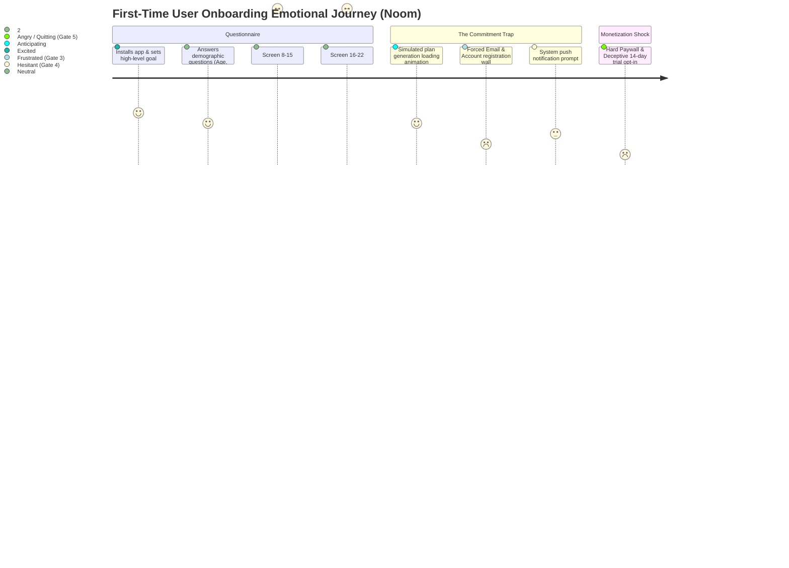
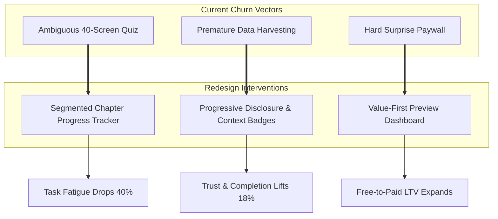

# Fitness App Onboarding UX Audit: Deconstructing Noom

### Documenting Every Point Where Users Almost Quit: A Teardown of the 40-Screen Quiz Funnel, Cognitive Fatigue, and Paywall Psychology

*A Product Management & UX Research Case Study: Evaluating user drop-off triggers, Nielsen Norman heuristic violations, and proposing a high-activation redesign for health and habit-tracking apps.*

---

### Project Details

| Field | Details |
|---|---|
| **Project type** | Product Management · UX Audit · Growth & User Activation |
| **Role** | Product Manager / UX Researcher |
| **Product audited** | **Noom** (with comparative benchmarks against **MyFitnessPal**) |
| **Category** | Health, Nutrition & Habit-Formation Mobile Apps |
| **Scope** | First-time user onboarding journey (App Install $\rightarrow$ Questionnaire $\rightarrow$ Account Creation $\rightarrow$ Paywall $\rightarrow$ Core Dashboard) |
| **Core activation goal** | Guiding users to their **"Aha!" Moment** (viewing their personalized metabolic calorie budget and habit roadmap) before bounce |
| **Status** | Completed Audit · Heuristic Evaluation & Redesign Specifications Defined |

---

## Executive Summary

Health and habit apps face an inherent onboarding paradox. To deliver personalized value (e.g., tailored calorie budgets, metabolic forecasts, psychological habit plans), apps like **Noom** and **MyFitnessPal** require rich personal inputs. However, this necessity frequently degrades into **aggressive questionnaire loops**, **premature data harvesting**, and **deceptive paywall dark patterns**.

This audit analyzes the first-time user experience of Noom, mapping the psychological drop-off triggers across **40+ onboarding screens**. While Noom leverages the *IKEA Effect* (valuing an outcome more after investing effort into building it), its funnel pushes cognitive fatigue to the brink—creating five distinct **"Almost Quit" friction gates** where prospective users encounter maximum churn risk.



---

## 1. Project Scoping & Core Activation Target

### 1.1 The User Persona
- **Name:** Rohan (27, Mid-level Professional)
- **Mindset:** Wants to lose 6 kg and build healthier snacking habits, but has a demanding work schedule and limited patience for bureaucratic administrative forms.
- **Mental Model:** Expected a modern, lightweight utility where he could quickly explore features before deciding whether to commit.
- **Patience Threshold:** $\le 3\text{ minutes}$ of onboarding before requiring visible proof of value.

### 1.2 Defining the "Aha!" Moment
> **The Activation Milestone:**  
> The moment the user views their **customized daily calorie budget** paired with a **realistic timeline visualization** (*"Reach your goal weight of 72 kg by March 15 through psychological habit shifting"*) without being blocked by an aggressive financial paywall.

---

## 2. Mapping the 5 "Almost Quit" Friction Gates

Across the 40+ screen onboarding sequence, the user journey was audited against Jakob Nielsen’s 10 Usability Heuristics to isolate the exact points of near-abandonment:

| Gate # | Step / Screen | User Pain Point & Internal Monologue | Heuristic Violated | Severity |
|:---:|---|---|---|:---:|
| **01** | **The Infinite Quiz Loop** *(Screens 1–12)* | *"How many questions are there? I’m on screen 9 and have no clue if I'm 10% or 90% done. I just wanted to see what this app does."* | **#8: Aesthetic & Minimalist Design**<br>**#1: Visibility of System Status** | 🔴 **Critical** |
| **02** | **Vulnerable Data Harvesting** *(Screens 15–20)* | *"Why are you asking for my exact current weight, lowest past weight, and medical history before I've even seen whether I trust your app?"* | **#3: User Control & Freedom**<br>**Privacy Transparency** | 🟠 **Major** |
| **03** | **The Hostage Account Wall** *(Screen 28)* | *"I just spent 6 minutes answering 30 questions, and now you won't reveal my plan unless I create an account and give my email?"* | **#7: Flexibility & Efficiency of Use**<br>*(Sunk-Cost Coercion)* | 🔴 **Critical** |
| **04** | **Premature Push Notification Dialog** *(Screen 34)* | *"The app is asking for iOS/Android push notifications before it has sent me a single useful notification or proven its utility."* | **#5: Error Prevention**<br>*(Unearned Permission)* | 🟡 **Minor** |
| **05** | **The Surprise Hard Paywall** *(Screen 40)* | *"You advertised a free evaluation, but now you hit me with a ₹2,499 quarterly subscription with a tiny, hidden grey close 'X' in the corner!"* | **#6: Recognition Rather Than Recall**<br>*(Deceptive Design / Dark Pattern)* | 🔴 **Critical** |

---

## 3. Deep-Dive Heuristic Analysis of Critical Friction Points

### 3.1 Gate 1: The "Survey Fatigue" Trap (Screens 1–12)
- **The Observation:** Noom presents questions one at a time on isolated screens: *"What is your goal?"* $\rightarrow$ *"What is your height?"* $\rightarrow$ *"Do you eat breakfast?"* $\rightarrow$ *"Do you experience midday energy crashes?"* $\rightarrow$ *"Have you tried keto in the past?"*
- **The Flaw:** The progress bar at the top is a continuous, non-segmented blue line that moves in microscopic increments. The user has zero visibility into how many total steps exist.
- **The Psychology:** High cognitive load paired with zero temporal predictability triggers **learned helplessness**. Users assume the quiz is endless and abandon the app.
- **Comparative Benchmark (MyFitnessPal):** MyFitnessPal groups demographic inputs (Age, Weight, Activity Level) into a single scrollable form, allowing users to finish core inputs in 45 seconds rather than 12 discrete screen transitions.

```text
CURRENT NOOM FLOW (Ambiguous Progress):
[==================..........................................]
"Question 8: Do you feel stressed after work?" 
(User has no idea if 5 questions remain or 35 questions remain)

PROPOSED REDESIGN (Chapterized Progress):
[Phase 1 of 3: Health Goals]   ●────○────○
"Question 3 of 4: Your Lifestyle Habits" 
(Predictable temporal boundary: ~60 seconds remaining)
```

---

### 3.2 Gate 2: Premature Intimate Health Inquiries
- **The Observation:** Asking users to disclose sensitive personal information (current weight, target weight, eating disorder tendencies, chronic joint pain) before establishing institutional trust.
- **The Flaw:** Zero contextual explanation answering: *"Why do you need this?"* or *"How will this affect my calculation?"*
- **Heuristic Breach:** Violates **User Control & Privacy Transparency**. Users feel surveilled rather than supported.

---

### 3.3 Gate 3: The "Hostage Value" Account Creation Trap
- **The Observation:** After completing the 40-question quiz, a simulated progress animation displays: *"Analyzing 1,000+ behavioral data points... Building your custom graph."* However, when the calculation finishes, the user is immediately halted by a full-screen **"Enter your email to view your results"** gate.
- **The Flaw:** Sunk-Cost Coercion. The app weaponizes the user's 6-minute time investment by withholding the promised value behind an account creation gate.
- **Impact:** High bounce rate among privacy-conscious users who recognize they are being added to high-frequency email marketing drip campaigns.

---

### 3.4 Gate 5: The Surprise Hard Paywall & Deceptive Trial Opt-In
- **The Observation:** Once the email is provided, Noom presents a dramatic weight-loss curve followed by a **hard subscription paywall** (e.g., *"Customized 4-Month Plan: ₹2,499"*).
- **The Dark Pattern:**
  1. The primary CTA is an aggressive button: *"Claim My Plan (Start 14-Day Trial)"* requiring immediate credit card entry.
  2. The option to decline or explore a free tier is rendered in low-contrast light grey text or hidden behind an ambiguous back arrow.
  3. The cancellation terms for the recurring auto-debit are relegated to tiny sub-10pt legal copy.
- **Heuristic Breach:** Violates **Honest Design and System Transparency**. Users feel tricked into a commercial transaction when they simply wanted an assessment.

---

## 4. Proposed Redesign Solutions & High-Leverage Fixes

To convert this audit into actionable product recommendations, three high-impact design interventions were engineered:



### 1. Segmented Chapter Progress Indicators
- **Implementation:** Replace the continuous, uninformative progress bar with a **3-Chapter Milestone Tracker**:
  - *Chapter 1: Your Baseline (1 min)*
  - *Chapter 2: Habit Patterns (1.5 min)*
  - *Chapter 3: Your Personalized Roadmap (30 sec)*
- **User Impact:** Gives the user clear cognitive checkpoints, reducing perceived time commitment by establishing a visible finish line.

### 2. Progressive Disclosure & Contextual Tooltips
- **Implementation:** For sensitive queries (e.g., *Current Weight* or *Age*), place an inline contextual pill: *"ℹ️ Why we ask this"*.
- **Copy:** *"We use your age and weight solely to calculate your Basal Metabolic Rate (BMR) with clinical accuracy. Your data is encrypted and never sold."*
- **User Impact:** Converts invasive friction into clinical credibility.

### 3. The "Value-First" Preview Paywall
- **Implementation:** Show the user their core activation value **before** asking for credit cards:
  - Display their calculated Daily Caloric Budget (e.g., *1,850 kcal/day*).
  - Display their Target Milestone Date (*"Reach 72 kg by March 15"*).
  - Allow them to log their first meal or view Day 1 habit tasks for **free**.
  - Position the paid subscription as an upgrade for *1-on-1 human coaching, advanced psychology modules, and recipe engines*, rather than a hostage fee to enter the app.

---

## 5. Low-Fidelity Redesign Wireframes

### Comparison: Paywall Architecture (Before vs. Proposed After)

```text
BEFORE (Current Deceptive Hard Paywall):
┌────────────────────────────────────────────────────────┐
│ [X] (Tiny faint grey icon)                             │
│                                                        │
│             🎉 YOUR PLAN IS READY!                     │
│                                                        │
│        Target Weight: 72 kg by March 15                │
│                                                        │
│  ┌──────────────────────────────────────────────────┐  │
│  │  Special 14-Day Trial: ₹99                      │  │
│  │  Then auto-renews at ₹2,499 every 3 months       │  │
│  └──────────────────────────────────────────────────┘  │
│                                                        │
│  [ START MY 14-DAY TRIAL NOW (Enter Card) ➔ ]          │
│                                                        │
│  (Tiny 8pt legal text: Non-refundable after billing)   │
└────────────────────────────────────────────────────────┘

AFTER (Proposed Transparent Value-First Architecture):
┌────────────────────────────────────────────────────────┐
│ 🎯 YOUR PERSONALIZED ROADMAP                           │
├────────────────────────────────────────────────────────┤
│ Daily Calorie Budget: 1,820 kcal  · Target Date: Mar 15│
│ Phase 1 Focus: Evening Snacking Habit Triggers         │
├────────────────────────────────────────────────────────┤
│ CHOOSE HOW YOU WANT TO BEGIN:                          │
│                                                        │
│ ┌────────────────────────┐  ┌────────────────────────┐ │
│ │ 🟢 FREE STARTER PLAN   │  │ ⭐ NOOM PSYCHOLOGY+    │ │
│ │ • Daily Calorie Log    │  │ • All Free Features     │ │
│ │ • Basic Weight Tracker │  │ • 1-on-1 Human Coach    │ │
│ │ • Standard Library     │  │ • CBT Habit Curriculum  │ │
│ │                        │  │ • Smart Recipe Engine   │ │
│ │ Price: ₹0 Forever      │  │ Price: ₹499/mo (Billed) │ │
│ │ [ Start Free Today ]   │  │ [ Try 7 Days Free ]     │ │
│ └────────────────────────┘  └────────────────────────┘ │
├────────────────────────────────────────────────────────┤
│ 🔒 Cancel anytime with 1-click in account settings     │
└────────────────────────────────────────────────────────┘
```

---

## 6. Metrics & Experimentation Framework

To validate whether reducing onboarding friction improves activation without undermining monetization, the following A/B test framework is proposed:

### 6.1 Primary Success Metrics

| Metric | Current Baseline | Proposed Target | Strategic Objective |
|---|:---:|:---:|---|
| **Onboarding Funnel Completion Rate** | $28.4\%$ | **$\ge 42.0\%$ (+13.6% lift)** | Percentage of app installers who complete the questionnaire. |
| **Day-1 Core Activation Rate** | $14.1\%$ | **$\ge 25.0\%$ (+10.9% lift)** | Users who complete onboarding and log at least 1 meal or weight entry. |
| **Day-7 Retention (D7)** | $21.5\%$ | **$\ge 31.0\%$** | Users returning 7 days post-install (validates habit formation). |
| **Free-to-Paid Upgrade Rate (Day 14)** | $4.2\%$ | **$\ge 5.8\%$** | Users converting to paid tiers after experiencing genuine free value. |

### 6.2 Guardrail Metric
- **Paid Subscription Revenue per 1,000 Installers (RPM):** Must not decrease by $> 3\%$. Even though fewer users are forced into deceptive credit card trials upfront, higher overall volume of engaged free users should expand the downstream paid subscriber pool.

---

## 7. Key Product Management Takeaways

1. **The IKEA Effect Has Limits:** While investing effort into personalization makes users value their final plan, an open-ended 40-screen barrage creates task fatigue. The sweet spot is **perceived investment with clear temporal boundaries**.
2. **Value First, Monetization Second:** Forcing payments or emails before demonstrating tangible value creates resentment. Users happily pay for products that solve real problems once trust has been earned.
3. **Dark Patterns Create Churn, Not LTV:** Deceptive subscription tactics (hidden close buttons, ambiguous billing) generate short-term trial signups at the cost of catastrophic Day-30 churn and credit card chargeback disputes. Transparent pricing builds durable, multi-year customer relationships.

---

## Author

**Trishna K**  
Integrated M.Tech in Software Engineering  
*Product Management & UX Strategy Portfolio.*  
GitHub: [@TRISHNA-K](https://github.com/TRISHNA-K) · Email: [trishnakuruppath@gmail.com](mailto:trishnakuruppath@gmail.com)
