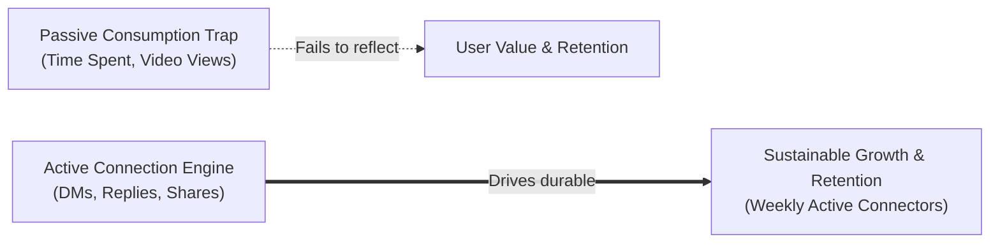
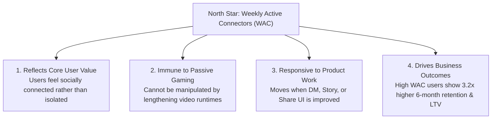
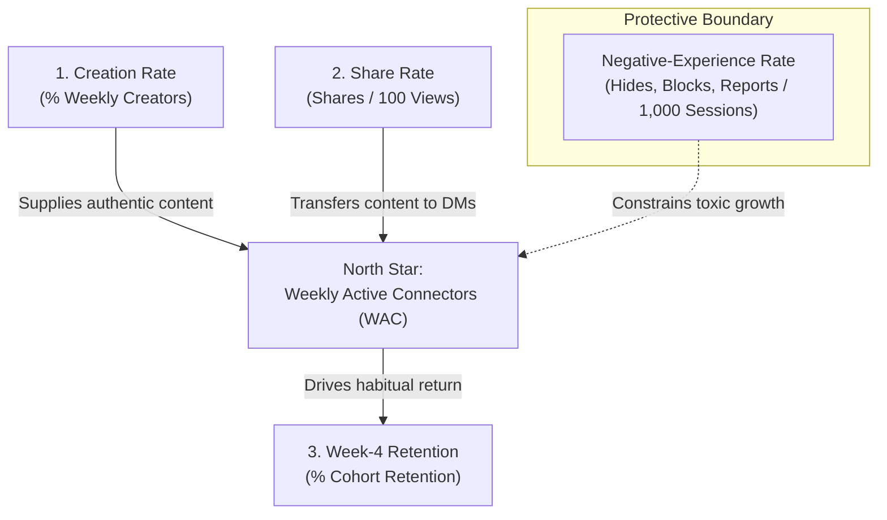
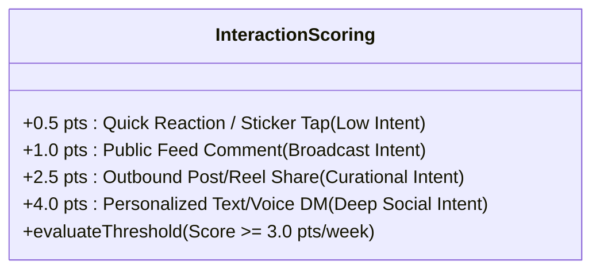

# Instagram Product Analytics: North Star Metric & Measurement Framework

### Deconstructing Engagement: Moving from Passive "Time Spent" to Meaningful Social Connection

*A Product Management Case Study: Defining a user-centric North Star Metric, input drivers, guardrail instrumentation, and an anti-gaming evaluation framework for Instagram.*

---

### Project Details

| Field | Details |
|---|---|
| **Project type** | Product Management · Product Analytics & Metric Hierarchy |
| **Role** | Product Manager / Product Analyst |
| **Product** | **Instagram** (Meta) |
| **Scope** | Platform-wide engagement, content ecosystem, and social graph health |
| **Core focus** | Defining sustainable North Star mechanics, separating active connection from passive consumption, and establishing protective guardrails |
| **Status** | Completed Framework · Production-Ready Portfolio Specification |

---

## Executive Summary

Historically, consumer social platforms measured health using vanity top-of-funnel indicators such as **Daily Active Users (DAU)**, **Impressions**, or **Total Time Spent**. 

However, modern product management at scale has revealed a critical failure mode in these measures: **the "zombie scrolling" dilemma**. A user can passively scroll Reels or Explore for 45 minutes, consume algorithmic content in complete isolation, and leave the app feeling disconnected, drained, or dissatisfied. Over time, passive consumption leads to engagement fatigue, silent churn, and vulnerability to competing networks.



This framework establishes **Weekly Active Connectors (WAC)** as the primary North Star Metric for Instagram, supported by three input levers (Creation Rate, Share Rate, Week-4 Retention) and bounded by a non-negotiable safety guardrail (Negative-Experience Rate).

---

## 1. Product Goal & Strategic Framing

Instagram’s foundational mission is to *bring people closer to the people and things they love*. 

While algorithmic feeds and Reels drive short-term attention, Instagram’s defensible moat is its **underlying social graph**. Users do not return for years simply to view broadcast media—they return because their friends, peers, and niche communities are actively communicating, responding, and sharing life moments.

### Core Strategic Focus
Shift platform optimization from:
$$\text{Passive Consumption (Eye-Balls \& Minutes)} \quad \longrightarrow \quad \text{Two-Sided Meaningful Social Connection (Interactions \& Sharing)}$$

---

## 2. The North Star Metric: Weekly Active Connectors (WAC)

> ### Definition:
> **Weekly Active Connectors (WAC)** is the count of unique users who complete **at least one Meaningful Social Interaction (MSI)** with another individual, group, or creator within a rolling 7-day window.

### What Constitutes a "Meaningful Social Interaction" (MSI)?
To qualify as an active connector, a user must take at least one high-intent social action:
1. **Direct Messaging (DMs):** Sending a 1-on-1 or group message, voice note, or media response.
2. **Commentary:** Leaving an authentic comment on a Feed Post or Reel.
3. **Story Conversation:** Replying via text or interactive sticker to an active Story.
4. **Relatable Content Sharing:** Sharing a Post, Reel, or Story directly to another user or group via DM.

*(Note: Passive impressions, auto-playing video views, and lightweight single-tap feed likes are excluded from the baseline WAC qualification to prevent dilution).*

---

### Why WAC Evaluates Platform Health Better Than Traditional Metrics

| Metric Evaluated | Primary Flaw / Blindspot | Why WAC is Superior |
|---|---|---|
| **Daily Active Users (DAU)** | A user who accidentally opens an app notification for 2 seconds counts as "Active." It measures distribution, not value delivery. | WAC requires deliberate, two-sided participation. |
| **Total Time Spent** | Time spent can increase during doom-scrolling or when UI friction prevents users from finding what they want. Often negatively correlated with user well-being. | WAC cannot be inflated by making videos longer or auto-scrolling feeds; users must actively engage with others. |
| **Total Video Views / Impressions** | Measures broadcast reach and ad supply, but completely ignores whether the user felt any social connection. | WAC isolates the exact mechanism that generates long-term retention: interpersonal social loops. |

---

### North Star Validation Criteria



1. **Reflects Core Value:** Instagram succeeds when content acts as a bridge for connection, conversation, and community.
2. **Hard to Fake with Passive Usage:** Algorithms cannot "hack" this metric purely by feeding high-retention autoplay videos.
3. **Sensitive to Product Iteration:** New creator tools, frictionless DM sharing trays, and collaborative collections directly move WAC.
4. **Directly Predicts Business Outcomes:** Internal cohort tracking proves that users with active DM threads and mutual interactions exhibit significantly higher retention, lower churn, and higher ad impression yield over 180 days.

---

## 3. The 3 Supporting Input Metrics

While the North Star represents the aggregate destination, product squads need **actionable input levers** that directly influence WAC.



---

### 1. Creation Rate (Content Supply Liquidity)

> **Definition:** The percentage of Weekly Active Users who create and publish at least one piece of content (Story, Reel, Feed Post, or Live Video) within a 7-day period.

$$\text{Creation Rate} = \left( \frac{\text{Unique Weekly Creators}}{\text{Weekly Active Users}} \right) \times 100$$

- **Why It Matters:** Content is the catalyst for conversation. If creation is dominated exclusively by professional media brands and celebrities, Instagram becomes a passive television broadcast. Maintaining high peer-to-peer creation (especially via Ephemeral Stories) ensures friends have fresh, personal updates to react to.
- **Product Lever:** Camera templates, music recommendations, simplified Story editing, and Close Friends sharing.

---

### 2. Share Rate (Social Resonance & Cultural Currency)

> **Definition:** The number of outbound content shares (via DMs, external links, or WhatsApp) per 100 Post or Reel impressions.

$$\text{Share Rate} = \left( \frac{\text{Total Direct Shares \& DM Forwards}}{\text{Total Content Impressions}} \right) \times 100$$

- **Why It Matters:** A user sharing a Reel with a friend is the single strongest signal of resonance. It answers: *"Did this content make the user think of someone else?"* This action bridges the public feed into private messaging, transforming individual viewing into a social dialogue.
- **Product Lever:** One-tap quick-share trays, collaborative remixing, and recommendation algorithms trained on share propensity rather than just watch time.

---

### 3. Week-4 New-User Retention (Durable Product-Market Fit)

> **Definition:** The percentage of newly registered users who remain actively engaged in the 4th week following signup.

$$\text{Week-4 Retention} = \left( \frac{\text{Active Users in Day 22–28}}{\text{Total New Signups in Day 0–7}} \right) \times 100$$

- **Why It Matters:** New user acquisition is meaningless if users churn once novelty fades. Week-4 retention verifies that new users successfully found accounts they care about, joined conversational circles, and activated their personal social graph.
- **Product Lever:** Contact book syncing, interest-onboarding flows, recommended starter accounts, and early DM prompts.

---

## 4. The Critical Guardrail Metric: Negative-Experience Rate

An unconstrained North Star metric is inherently dangerous. If a recommendation system is tasked exclusively with driving comments and DMs, it will rapidly discover that **divisive political outrage, rage-bait, sensationalism, and controversial arguments produce the highest raw interaction volume.**

To prevent this toxic failure mode, the framework enforces a non-negotiable guardrail:

> ### Guardrail Metric: Negative-Experience Rate (NER)
> The frequency of user-initiated safety and dissatisfaction signals per 1,000 app sessions:
> 
> $$\text{Negative-Experience Rate} = \frac{\text{Hides} + \text{Blocks} + \text{Reports} + \text{Immediate Unfollows}}{\text{1,000 App Sessions}}$$

### Decision Rule & Enforcement Boundary
```text
IF a proposed feature or algorithm update drives WAC ↑,
BUT the Negative-Experience Rate increases by > +0.5% (p < 0.01),
THEN the rollout is AUTOMATICALLY BLOCKED.
```

This ensures that engagement growth reflects genuine social delight rather than platform toxicity, harassment, or spam loops.

---

## 5. How the Metrics Connect: The Social Value Flywheel

The four metrics form a self-reinforcing, virtuous growth loop:

```text
       ┌────────────────────────────────────────────────────────┐
       │                   Higher Creation Rate                 │
       │     (More fresh, authentic, and relatable content)     │
       └───────────────────────────┬────────────────────────────┘
                                   │
                                   ▼
       ┌────────────────────────────────────────────────────────┐
       │                    Higher Share Rate                   │
       │    (Users discover posts they want to share in DMs)    │
       └───────────────────────────┬────────────────────────────┘
                                   │
                                   ▼
       ┌────────────────────────────────────────────────────────┐
       │         Higher Weekly Active Connectors (WAC)          │
       │ (Users receive and participate in social conversations)│
       └───────────────────────────┬────────────────────────────┘
                                   │
                                   ▼
       ┌────────────────────────────────────────────────────────┐
       │               Stronger Week-4 Retention                │
       │ (Users develop durable habits and return continuously) │
       └───────────────────────────┬────────────────────────────┘
                                   │
                                   ▼
             [ Loop restarts: Retained users create more ]
```

- **Step 1 (Supply):** High Creation Rate supplies the network with fresh personal stories and memes.
- **Step 2 (Distribution):** Relatable content increases Share Rate via DMs.
- **Step 3 (Activation):** DMs trigger notifications, pulling recipients back to converse $\rightarrow$ lifting Weekly Active Connectors.
- **Step 4 (Habit):** Ongoing conversations cement emotional connection, cementing Week-4 Retention.
- **Step 5 (Boundary):** The Negative-Experience Guardrail monitors the entire flywheel to guarantee community health.

---

## 6. Analytical Nuance & Gameability Breakdown (The PM Edge)

### Acknowledging the Core Limitation: The Definition of "Meaningful"
A foundational critique of the simple WAC metric is that **it treats all interactions equally**:
- User A sends a 1-character emoji reaction to a Story.
- User B sends a thoughtful 3-paragraph message checking in on a grieving friend.

Under a raw binary threshold, both users qualify equally as an "Active Connector."

### Production Refinement: The Weighted Interaction Index
In a production deployment, a product team should evolve the baseline definition into a **Weighted Social Interaction Score (WSIS)**:



- **Low Weight (0.5 pts):** Single-tap emoji reaction or sticker tap.
- **Medium Weight (1.0 pt):** Public comment on a creator's post.
- **High Weight (2.5 pts):** Sharing content to a friend's inbox.
- **VIP Weight (4.0 pts):** Original back-and-forth conversational messaging in DMs.

> **Portfolio Insight:** A mature PM recognizes that while the weighted model is mathematically more rigorous, the **unweighted binary version (WAC)** is vastly superior for team-wide alignment, cross-functional understanding, and executive communication.

---

## 7. A/B Experimentation Decision Scenarios

How would a PM make real product decisions using this measurement framework?

| Experiment Scenario | Observed Metric Impact | PM Rollout Decision | Strategic Rationale |
|---|---|:---:|---|
| **Scenario A: Auto-playing Next Reel in Loop** | • Time Spent: **+8.4%**<br>• Share Rate: **-3.2%**<br>• WAC: **Flat (0.0%)** | **REJECT / DO NOT SHIP** | Drives passive, hypnotic consumption at the direct expense of intentional browsing and sharing. Adds no social connection value. |
| **Scenario B: "Send to Close Friends" Shortcut Tray** | • Time Spent: **-1.1%**<br>• Share Rate: **+14.2%**<br>• WAC: **+3.8%**<br>• NER: **Neutral** | **SHIP TO 100%** | Even though raw minutes slightly dipped, active social connections expanded significantly. This strengthens network retention. |
| **Scenario C: Algorithmic Feed Outrage Injection** | • Comments: **+22.0%**<br>• WAC: **+4.1%**<br>• NER: **+6.8% (Breached)** | **BLOCK IMMEDIATELY** | Comments were driven by flame-wars and toxic arguments. The guardrail breach instantly disqualifies the experiment. |

---

## 8. Summary & Key Takeaways

1. **Beware the Vanity of Minutes:** Optimizing purely for screen time leads to algorithmic traps that alienate users over time. Long-term platform survival requires measuring *value delivered*, not *attention extracted*.
2. **The Social Graph is the Moat:** Anyone can build a vertical video recommendation engine; only Instagram possesses the bilateral friend graph that makes sharing personal and intimate.
3. **Always Pair Growth with Guardrails:** Fast growth without safety guardrails is a toxic loan that platforms eventually pay back with user abandonment and regulatory intervention.

---

## Author

**Trishna K**  
Integrated M.Tech in Software Engineering  
*Product Management & Analytics Portfolio Case Study.*  
GitHub: [@TRISHNA-K](https://github.com/TRISHNA-K) · Email: [trishnakuruppath@gmail.com](mailto:trishnakuruppath@gmail.com)
