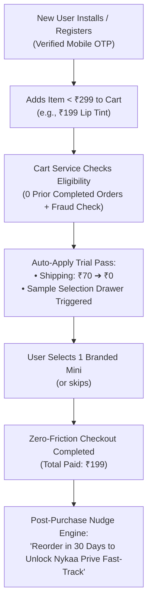
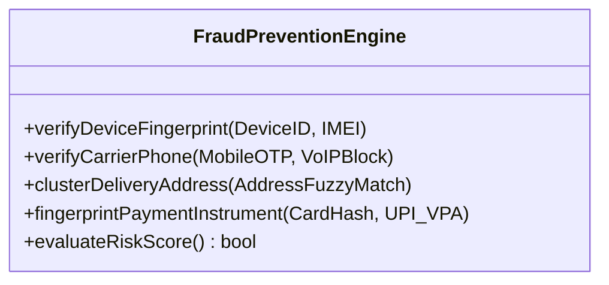
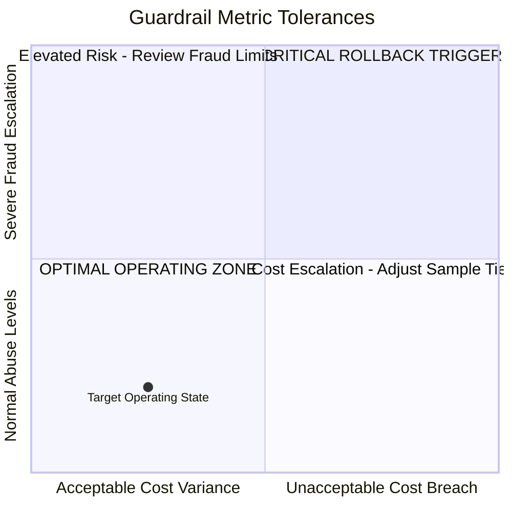
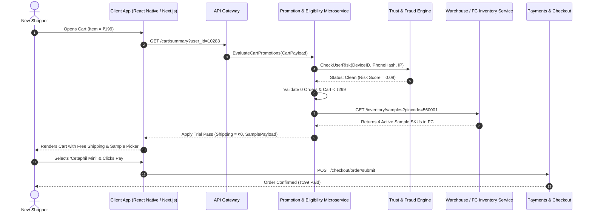
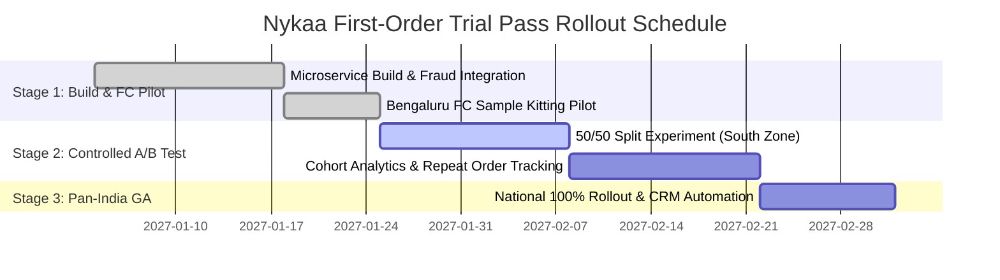

# Product Requirement Document (PRD): Nykaa First-Order Beauty Trial Pass

### Eliminating Checkout Friction for Small-Basket New User Acquisition & Repeat Conversion

*A comprehensive, execution-ready Product Requirement Document (PRD) authored from a Senior Product Manager / Technical Program Manager perspective.*

---

## Document Metadata

| Attribute | Details |
|---|---|
| **Document Status** | **Approved for Sprint Planning & Technical Review** |
| **Product** | **Nykaa E-Commerce** (Core Mobile Apps & Web Checkout) |
| **Feature Name** | **First-Order Beauty Trial Pass** |
| **Feature Lead / PM** | **Trishna K** (Integrated M.Tech in Software Engineering) |
| **Target Release Window** | Q1 MVP Launch (Phased A/B Experimentation) |
| **Stakeholders** | Product (Growth & Checkout), Engineering (Cart/Promotion Microservice), UX/UI Design, Data/Analytics, Fraud & Trust, Supply Chain Operations (FC Kitting) |

---

## 1. Executive Summary & Problem Statement

### 1.1 The Business & User Problem
Nykaa is the market-leading beauty e-commerce platform in India, renowned for product authenticity and massive catalogue breadth. However, top-of-funnel conversion suffers from a structural barrier in its shipping policy:

> **Current Nykaa Shipping Policy:**  
> Free delivery is granted on orders of **₹299 and above**; all orders below ₹299 incur a mandatory **₹70 shipping charge** [[Nykaa Shipping Policy](https://www.nykaa.com/shipping-policy)].

For a prospective new user—particularly college students, Tier-2/3 shoppers, or first-time online beauty buyers—who wants to make a small, low-risk trial purchase (e.g., an ₹180 kajal or a ₹199 lipstick), the ₹70 delivery fee increases their cart checkout cost by **+35% to +39%**.

```text
┌────────────────────────────────────────────────────────┐
│ THE FIRST-TIME BUYER FRICTION TRAP                     │
├────────────────────────────────────────────────────────┤
│ Prospective Customer adds ₹199 Lipstick                │
│                                                        │
│ Option A: Pay ₹70 Shipping (Total: ₹269)               │
│           └── Feels punitive; user abandons cart       │
│                                                        │
│ Option B: Artificially pad cart to cross ₹299          │
│           └── User lacks platform trust; hesitates     │
│                                                        │
│ Result: ➔ Cart Abandonment & Lost Customer Lifetime Value│
└────────────────────────────────────────────────────────┘
```

### 1.2 Competitive Threat
Direct competitors aggressively exploit this friction point:
- **Purplle:** Subsidizes smaller baskets through low-cost Elite memberships (free shipping above ₹149) and promotional zero-shipping trial offers.
- **Quick-Commerce (Blinkit, Zepto):** Delivers single-item beauty and personal care essentials in 10 minutes with low or zero delivery thresholds.

### 1.3 The Strategic Opportunity
Customer acquisition cost (CAC) for beauty shoppers via Meta/Google ads ranges between **₹350 and ₹600**. Paying ₹70 in subsidized logistics to guarantee a user's first successful order is an order-of-magnitude more capital-efficient than losing an interested shopper and paying retargeting ad dollars.

---

## 2. Target Users & Jobs To Be Done (JTBD)

### 2.1 User Personas

| Persona Archetype | Demographics & Context | Core Pain Point | Behavioral Goal |
|---|---|---|---|
| **Primary: The Cautious Trial Buyer** *(65% of target)* | College students, first-time wage earners (Ages 18–24). High price sensitivity, low initial platform familiarity. | Wants to test shade, skin compatibility, and delivery reliability with a single ₹150–₹250 item without paying ₹70 shipping. | Place a friction-free trial order to evaluate service before committing larger budget. |
| **Secondary: The Dormant Re-Activator** *(35% of target)* | Registered users who created an account or haven't ordered in $\ge 90$ days. | Churned at previous checkouts due to shipping fees or lack of purchasing incentives. | Re-engage with the platform through a zero-risk welcome re-entry offer. |

### 2.2 Jobs To Be Done (JTBD) Framework
```text
When I discover a trending beauty product on Nykaa that I want to try for the first time,
I want to checkout my single low-priced item without paying a ₹70 delivery fee,
So that I can test the product authenticity and shipping speed without taking a large financial risk.
```

---

## 3. Product Scope & Functional Requirements

The **First-Order Beauty Trial Pass** is an automated, zero-coupon welcome benefit that waives the ₹70 shipping fee on a new user's first order under ₹299 and unlocks a complimentary branded sample mini at checkout.



### 3.1 Functional Requirements Matrix

| Req ID | Capability | Description | Priority |
|---|---|---|:---:|
| **FR-01** | **User Eligibility Engine** | System checks customer account state upon cart load: <br>• Must have **0 previously completed orders** on Nykaa (excluding cancelled/refunded). <br>• Account must be verified via phone OTP. | **P0 (Must Have)** |
| **FR-02** | **Cart Value Logic** | • Applies strictly to carts with subtotal **$<$ ₹299**.<br>• If cart value is $\ge ₹299$, standard platform free shipping is applied by default, and a toast displays: *"You've qualified for standard free shipping! Free sample still unlocked."* | **P0 (Must Have)** |
| **FR-03** | **Zero-Code Auto Application** | The pass must apply **automatically by default** in the cart summary without requiring users to search, copy, or type a promotional coupon code. | **P0 (Must Have)** |
| **FR-04** | **Branded Sample Picker Drawer** | When the Trial Pass is triggered, an interactive carousel displaying **3 to 5 curated deluxe samples/minis** (skincare, haircare, fragrance sachets) appears in the checkout drawer for ₹0. | **P0 (Must Have)** |
| **FR-05** | **Sample Optionality & Skip Logic** | Selecting a sample is completely optional. A clear *"No thanks, proceed to checkout"* button ensures the purchase flow is never blocked or slowed down. | **P0 (Must Have)** |
| **FR-06** | **Product & SKU Exclusions** | Bulk items, hazardous goods (pressurized aerosols requiring special freight), and negative-margin liquidation SKUs are excluded from Trial Pass qualification. | **P1 (Should Have)** |
| **FR-07** | **Prive Loyalty Fast-Track Hook** | Post-purchase thank you screen displays: *"Love your purchase? Place your 2nd order within 30 days to fast-track your journey to Nykaa Prive Member status!"* | **P1 (Should Have)** |

### 3.2 Out of Scope (V1 MVP)
- **Repeat Orders:** Trial Pass benefits are strictly non-renewable after Order #1 is delivered.
- **Sample Returns/Exchanges:** Free sample items are non-returnable and non-refundable.
- **Universal Policy Changes:** Standard ₹299 threshold for existing non-trial customers remains unchanged.

---

## 4. Anti-Fraud & Abuse Prevention Controls

Because free shipping and complimentary physical goods attract promotional abuse, the feature includes four defense layers:



1. **Device Fingerprinting:** Restricts Trial Pass redemption to one redemption per physical hardware identifier (IMEI / IDFV), preventing multi-account creation on a single device.
2. **Carrier-Validated Mobile OTP:** Virtual/VoIP phone numbers (burner accounts) are automatically rejected during registration.
3. **Delivery Address Clustering:** Machine-learning fuzzy matching flags multiple new accounts ordering trial passes to the identical hostel room or apartment unit within a 14-day window.
4. **Payment Instrument Limiter:** A specific Credit/Debit card or UPI VPA cannot be utilized across more than 2 distinct Trial Pass accounts.

---

## 5. User Experience & Checkout Wireframe

### Cart & Checkout Interface (Low-Fidelity Architecture)

```text
┌────────────────────────────────────────────────────────┐
│ 🛍️ NYKAA BAG (1 Item)                                  │
├────────────────────────────────────────────────────────┤
│ [PROMO BANNER]                                         │
│ 🎉 Welcome Offer Applied: First-Order Beauty Trial Pass│
│    • Free Shipping (₹70 Saved)                         │
│    • 1 Complimentary Deluxe Mini Unlocked              │
├────────────────────────────────────────────────────────┤
│ ITEM IN CART:                                          │
│ Maybelline Sensational Liquid Matte Lipstick (10ml)    │
│ Qty: 1                                        ₹199     │
├────────────────────────────────────────────────────────┤
│ 🎁 CHOOSE YOUR FREE WELCOME SAMPLE:                    │
│ ┌───────────────┐ ┌───────────────┐ ┌───────────────┐  │
│ │ Cetaphil Mini │ │ Plum Vitamin C│ │ Minimalist Sun │  │
│ │ Cleanser 15ml │ │ Serum 5ml     │ │ Fluid SPF50 10g│  │
│ │ [ + Add Free] │ │ [ + Add Free] │ │ [ + Add Free] │  │
│ └───────────────┘ └───────────────┘ └───────────────┘  │
│ [ Skip Sample Selection ]                              │
├────────────────────────────────────────────────────────┤
│ PRICE DETAILS:                                         │
│ Bag Total:                                    ₹199     │
│ Shipping Fee:                        ~~₹70~~  FREE     │
│ Complimentary Sample:                 ~~₹99~~ FREE     │
│ ────────────────────────────────────────────────────── │
│ Total Amount Payable:                         ₹199     │
│ (You saved ₹169 on this order!)                        │
├────────────────────────────────────────────────────────┤
│ [ PROCEED TO PAYMENT ➔ ]                               │
└────────────────────────────────────────────────────────┘
```

---

## 6. Success Metrics & Guardrail Framework

### 6.1 Primary Success Metrics

| Metric | Baseline | Target (8 Weeks Post-Launch) | Measurement Method |
|---|:---:|:---:|---|
| **First-Order Conversion Rate** | $14.2\%$ | **$24.0\text{--}28.0\%$ (+10–15% lift)** | New registered users with an item in cart who complete payment. |
| **Small-Cart Checkout Rate** | $8.6\%$ | **$\ge 28.0\%$ (+20% lift)** | Checkout completion rate specifically for carts under ₹299. |
| **60-Day Repeat Purchase Rate** | $16.5\%$ | **$\ge 25.0\%$** | Trial Pass customers who place order #2 within 60 calendar days. |
| **Sample Selection Rate** | N/A | **$\ge 60.0\%$** | Percentage of eligible checkouts that opt into a complimentary mini. |
| **Incremental Net Contribution** | Benchmark | **Net Positive within 90 Days** | Cumulative gross margin from repeat orders minus trial shipping subsidies. |

### 6.2 Guardrail Metrics (Risk Ceilings)



1. **Blended Logistics Cost per New User:** Capped at **$\le ₹65$ average fulfillment cost** via consolidated 3PL routing contracts.
2. **Return to Origin (RTO) Rate:** Must not exceed standard platform baseline of **$\le 5.2\%$**.
3. **Fraudulent / Duplicate Account Rate:** Must remain strictly under **$< 1.5\%$** of total redemptions.
4. **Blended AOV Cannibalization:** Average order value of existing user segments must not degrade by $> 2.0\%$.

---

## 7. System Architecture & Technical Specifications



### 7.1 Non-Functional Requirements (NFRs)
- **Latency SLA:** Eligibility and sample lookup response must execute in **$\le 80\text{ ms}$** (p99) to prevent checkout latency.
- **High Concurrency:** Must scale to withstand high-volume traffic bursts (up to **12,000 requests/second**) during flagship sales (e.g., *Nykaa Pink Friday Sale*).
- **Graceful Fallback:** If the sample inventory service experiences downtime, the system automatically fulfills free shipping and displays: *"Sample currently unavailable; enjoy your complimentary free shipping!"* (Never block order submission).

---

## 8. Rollout Strategy & Phased Experimentation

### Phase-Gated Release Schedule



### A/B Testing Configuration
- **Control Group (50% New Users):** Standard Nykaa policy (₹70 shipping applied on carts $< ₹299; no free sample).
- **Variant Group (50% New Users):** First-Order Beauty Trial Pass (₹0 shipping on carts $< ₹299 + 1 free branded mini).
- **Go / No-Go Decision Rule:** If Variant generates $\ge +10\%$ first-order conversion and exhibits $\ge 20\%$ 60-day repeat order velocity with negative fraud impact $< 1.5\%$, approve for **100% Pan-India General Availability (GA)**.

---

## 9. Key PM & Program Takeaways

1. **Strategic LTV Framing:** This PRD demonstrates that shipping is not merely an operational cost center—it is a **growth lever**. Subsidizing ₹70 on Order #1 is an investment in user activation that yields positive returns through repeat purchases.
2. **Defensible Trade-Offs:** Free shipping is gated by user tenure (new users only) and cart ceilings ($< ₹299$), ensuring the promotion does not erode high-value basket sizes from loyal buyers.
3. **Cross-Functional Rigor:** By pairing consumer psychology with warehouse fulfillment SLAs, sample kitting logistics, and fraud device-fingerprinting, this document reflects end-to-end product execution maturity.

---

## Author

**Trishna K**  
Integrated M.Tech in Software Engineering  
*Product Management & Analytics Portfolio.*  
GitHub: [@TRISHNA-K](https://github.com/TRISHNA-K) · Email: [trishnakuruppath@gmail.com](mailto:trishnakuruppath@gmail.com)
