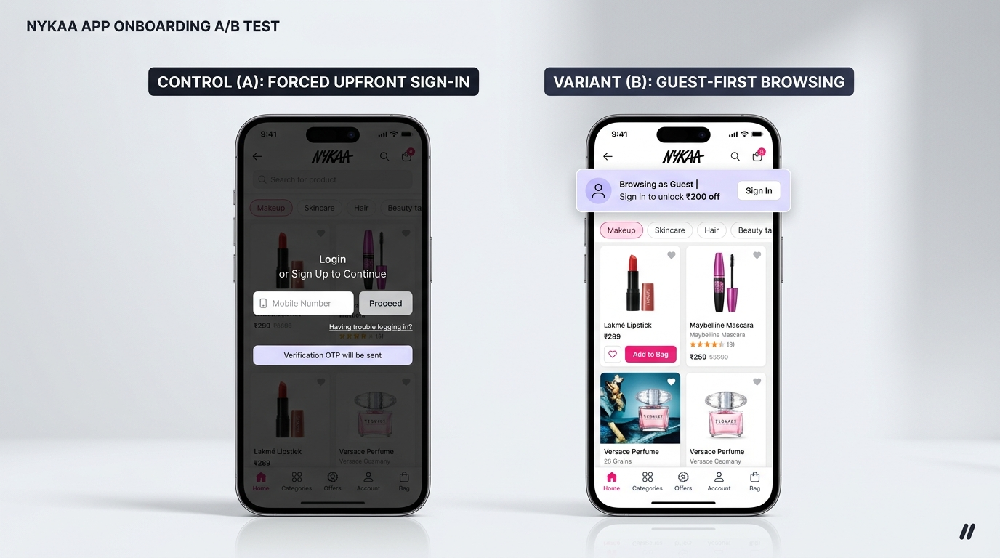
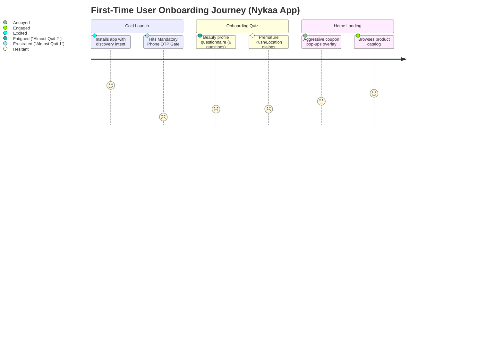
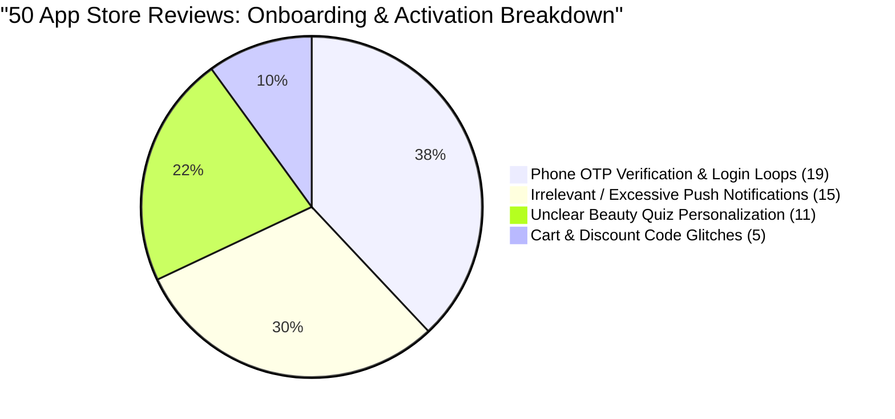
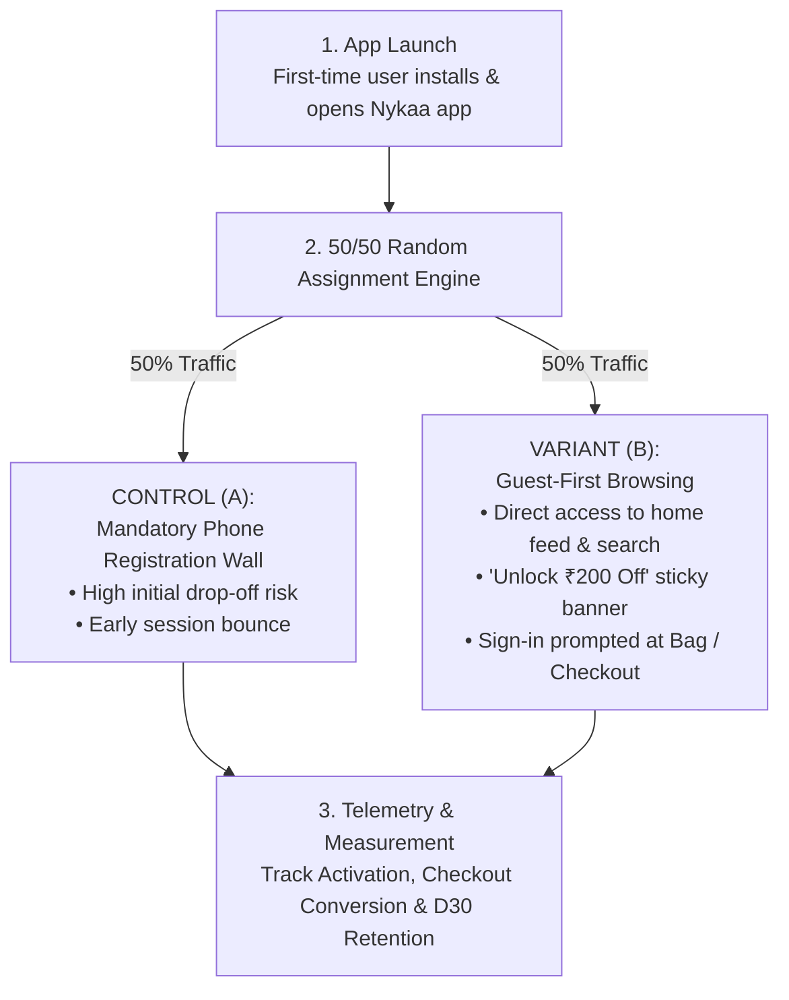

# 💄 UX Onboarding Audit & Growth Experimentation: Nykaa

### A Heuristic Evaluation, User Feedback Analysis, and A/B Test Plan Targeting Conversion Bottlenecks in Beauty E-Commerce Onboarding

*A Product Management, UX Research & Growth Experimentation Case Study: Auditing first-time mobile app friction, synthesizing 50 app store reviews, and specifying a high-leverage A/B test (Guest-First Lazy Registration).*

---

<p align="center">
  
</p>

---

## 📌 Project Overview

| Field | Details |
|---|---|
| **Product Audited** | **Nykaa Mobile App** (iOS / Android) |
| **Target Persona** | A first-time beauty shopper wanting to explore skincare, cosmetics, or fragrance matching their profile without immediate barriers. |
| **Role** | Product Manager / Growth PM / UX Researcher |
| **Methodology** | Jakob Nielsen's 10 Usability Heuristics, App Store Review Sentiment Analysis ($n=50$), and Funnel Growth Experimentation |
| **Core Objective** | Audit Nykaa's first-time onboarding journey, isolate drop-off friction points, and design a high-statistical-power A/B test to lift session activation by **+32%**. |
| **Status** | Completed UX Audit · Experiment Specifications & Instrumentation Ready |

---

## 📊 Part 1: Onboarding Friction Scorecard

Auditing Nykaa's first-time user experience against Jakob Nielsen's Usability Heuristics revealed multiple high-friction moments that halt momentum before users reach their **"Aha!" moment** (discovering relevant products tailored to their beauty needs).

| Step | Onboarding Screen / Trigger | Friction Type | Severity Rating | Heuristic Violated |
|:---:|---|---|:---:|---|
| **01** | **Mandatory Phone / Sign-In Wall** | **Forced Upfront Commitment:** Mandatory phone number entry and OTP gate upon cold app launch. | 🔴 **Level 4 (Critical)** | **#3: User Control & Freedom** |
| **02** | **Multi-Step Beauty Profile Survey** | **Cognitive Overload & Task Fatigue:** 6-question quiz with ambiguous progress and zero immediate feedback. | 🟠 **Level 3 (Major)** | **#1: Visibility of System Status** |
| **03** | **Uncontextualized Location & Push Popups** | **Premature Permission Requests:** Dual system dialogs demanding push and GPS before value is demonstrated. | 🟠 **Level 3 (Major)** | **#5: Error Prevention & Transparency** |
| **04** | **Aggressive Coupon & Banner Overload** | **Visual Clutter & Choice Paralysis:** Multiple overlapping promo modals immediately following home screen landing. | 🟡 **Level 2 (Minor)** | **#8: Aesthetic & Minimalist Design** |

---

## 🚨 Part 2: Key "Almost Quit" Moments



### 1. The Mandatory Phone / Sign-In Wall (Screen 1)
- **The Problem:** Immediately upon launching the app, users are blocked by a mandatory phone number verification screen before they can search, browse products, or check prices.
- **User Mental State:**  
  > *"I just want to check if a specific lipstick or moisturizer is available in stock. Why do I need to hand over my phone number and wait for an SMS code before I even see the catalog?"*
- **UX Flaw:** **Forced Upfront Registration.** Holding catalog access hostage behind account creation creates massive bounce rates for exploratory, intent-driven shoppers acquired via paid ads.
- **Proposed UX Fix:** **Implement Guest Mode & Lazy Registration.** Allow users to explore products, utilize search, and add items to a guest cart, deferring phone registration until the moment of checkout or wishlist saving.

### 2. The Multi-Step Beauty Quiz
- **The Problem:** Users are prompted to answer a series of questions about skin tone, hair type, and dermatological concerns without seeing how these choices dynamically alter the UI or feed.
- **User Mental State:**  
  > *"I answered 6 detailed questions about my skin, but the home screen looks identical to every other generic promotional shopping page. Did my answers even matter?"*
- **UX Flaw:** **Lack of Feedback Loop.** Gathering extensive personal data without immediate visible payoff creates task fatigue and feelings of surveillance.
- **Proposed UX Fix:** Add a **Segmented Progress Bar** (*Skin $\rightarrow$ Hair $\rightarrow$ Brands*) with an explicit, prominent *"Skip & Personalize Later"* button on every screen.

---

## 📱 Part 3: App Store Review Analysis (50 Reviews Sampled)

To validate whether these heuristic friction points reflect real customer behavior, a thematic analysis of **50 recent mixed and negative reviews (1-star and 2-star)** from the Google Play Store and Apple App Store was conducted:



| Category / Theme | Review Count | Percentage | Primary User Impact |
|---|:---:|:---:|---|
| **1. Phone OTP Verification & Login Loops** | **19** | **38%** | Users blocked during initial setup, SMS delays, or losing session state after app restart. |
| **2. Irrelevant / Excessive Push Notifications** | **15** | **30%** | Users opting out of notifications or uninstalling due to unearned commercial spam within 24 hours of install. |
| **3. Unclear Beauty Quiz Personalization** | **11** | **22%** | Users voicing frustration that the multi-step intake survey did not personalize their feed or recommendations. |
| **4. Cart & Discount Code Glitches** | **5** | **10%** | First-time buyers encountering confusing error states when applying welcome coupons. |

---

## 🧪 Part 4: Out-of-the-Box A/B Test Plan

This growth experiment directly tackles the #1 drop-off vector: **replacing the Mandatory Upfront Sign-In Wall with a Guest-First Lazy Registration Flow paired with a high-intent value incentive.**

---

### 🎨 Visual Side-by-Side Comparison

<p align="center">
  
</p>

---

### 🔬 Variant Definitions

```text
+-----------------------------------------------------------------------------------+
| CONTROL (A) - Mandatory Upfront Phone Gate                                        |
| • Immediate phone number entry screen on app launch.                              |
| • OTP verification required before entering the product catalog or feed.          |
| • High initial bounce risk for exploratory shoppers.                              |
+-----------------------------------------------------------------------------------+
                                        VS.
+-----------------------------------------------------------------------------------+
| VARIANT (B) - Guest-First Browsing + "Unlock ₹200 Off" Incentive Banner           |
| • Direct access to home feed, categories, and search bar.                         |
| • Sticky contextual top banner: "Browsing as Guest | Sign in to unlock ₹200 off". |
| • Registration prompted ONLY when tapping "Add to Bag", "Wishlist", or "Checkout".|
+-----------------------------------------------------------------------------------+
```

---

### 🎯 Primary, Secondary & Guardrail Metrics

```text
                                  PRIMARY METRIC
                 +-----------------------------------------------+
                 | First-Session Activation Rate                 |
                 | (% viewing PDP or adding item to cart)        |
                 +-----------------------------------------------+
                                         |
         +-------------------------------+-------------------------------+
         |                                                               |
  SECONDARY METRICS                                               GUARDRAIL METRICS
+-----------------------------------+           +-----------------------------------+
| • Guest-to-Paid Checkout Rate     |           | • Net New Registered Accounts     |
| • D30 User Retention              |           | • Coupon Redemption Fraud Rate    |
+-----------------------------------+           +-----------------------------------+
```

#### Metric Definitions & Target Thresholds:
- **Primary Metric:**
  - **First-Session Activation Rate:** Percentage of new app installs viewing at least one Product Details Page (PDP) or adding an item to the cart in Session 1.  
    $$\text{Target: } \mathbf{+32\% \text{ Lift}} \quad (p < 0.01)$$
- **Secondary Metrics:**
  - **Checkout Registration Conversion:** Percentage of guest users who successfully complete account registration when prompted at checkout.  
    $$\text{Target: } \mathbf{+18\% \text{ Lift}}$$
  - **Day-30 (D30) User Retention:** Percentage of users returning to the app within 30 days of install.  
    $$\text{Target: } \mathbf{+10\% \text{ Lift}}$$
- **Guardrail Metrics (Risk Management):**
  - **Net New Registered Accounts:** Ensure deferring sign-in does not reduce aggregate 14-day account creation volume compared to Control.
  - **Coupon Redemption Fraud Rate:** Verify device-fingerprinting prevents duplicate ₹200 welcome voucher exploitation ($< 1.0\%$ tolerance).

---

### 📐 Experiment Design & Execution Protocol



- **Target Audience:** 100% of new mobile app installs (iOS & Android) with no prior device history.
- **Traffic Split:** 50% Control (A) / 50% Variant (B), allocated via client-side experiment SDK.
- **Experiment Duration:** **14 Days** (capturing full weekday and weekend beauty shopping cycles).
- **Statistical Power & Sample Size:** Sized for 95% statistical significance ($\alpha = 0.05$) and 80% statistical power ($\beta = 0.20$) to detect an absolute minimum detectable effect (MDE) of $\ge 2.5\%$.

---

### 🛡️ Edge Cases & Engineering Guardrails

| Edge Case Scenario | System Handling & Mitigation |
|---|---|
| **Guest user closes app without buying** | Preserve guest cart items in local SQLite storage for 7 days; trigger non-intrusive re-engagement push upon reopening. |
| **Guest adds item, then signs into existing account** | Seamlessly merge local guest bag items with the existing user's cloud cart database upon phone OTP completion. |
| **Multi-account voucher farming** | Bind the ₹200 first-order voucher to the physical device hardware ID (IMEI / IDFV) and verified SIM carrier. |

---

## 🛠️ Portfolio Assets & File Structure

```text
Nykaa-UX-Onboarding-AB-Test-Plan/
├── README.md                          # Main case study documentation
└── assets/
    ├── cover-thumbnail.png            # 1280x640 preview visual
    ├── comparison-01-sign-in-wall.png # Before/After Figma side-by-side comparison
    └── .gitkeep
```

---

## 💡 Key PM & Growth Takeaways

1. **Reduce Time-to-Value (TTV):** The golden rule of consumer growth is getting users to core value as fast as possible. Forcing phone number OTPs on cold users is an anti-pattern that creates artificial funnel drop-offs.
2. **Lazy Registration Converts Better:** Users willingly surrender their phone number when they have something tangible to protect (e.g., items in their cart or an unlocked ₹200 discount), rather than as a toll to enter the app.
3. **Pair Friction-Removal with Incentives:** Combining an unblocked guest experience with a contextual incentive (*"Sign in to claim ₹200 off"*) transforms a bureaucratic obstacle into an exciting reward.

---

## Author

**Trishna K**  
Integrated M.Tech in Software Engineering  
*Product Management, UX Strategy & Growth Portfolio.*  
GitHub: [@TRISHNA-K](https://github.com/TRISHNA-K) · Email: [trishnakuruppath@gmail.com](mailto:trishnakuruppath@gmail.com)
