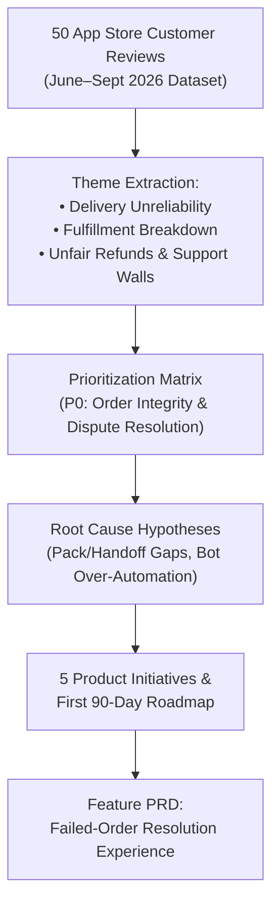
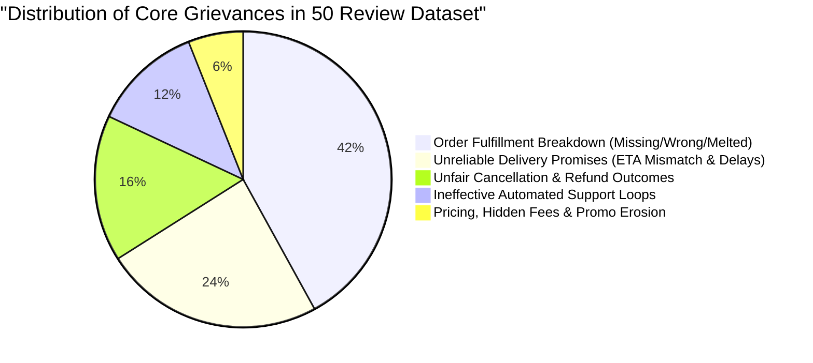
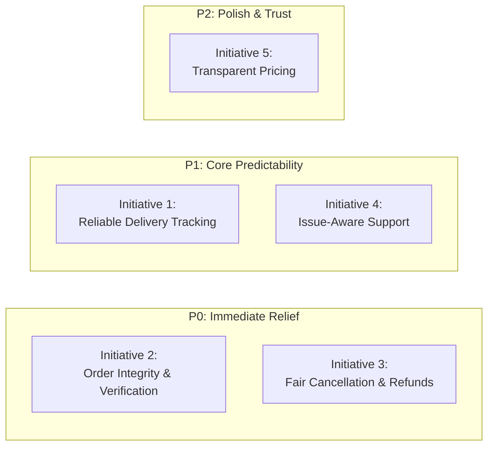
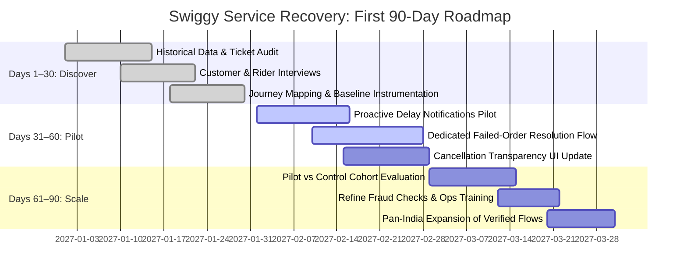
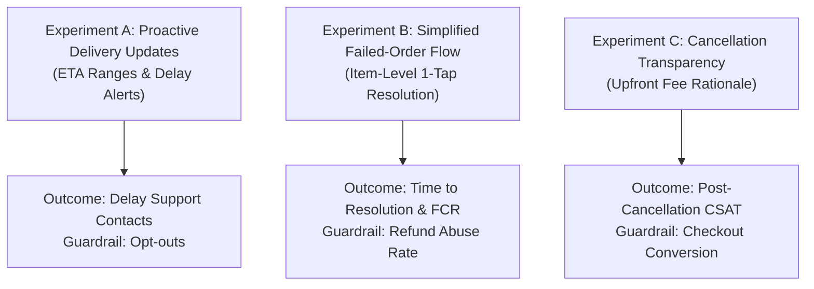

# Swiggy Product Management Case Study

### Customer Review Analysis • Problem Discovery • Prioritization • Product Roadmap

*A comprehensive Voice of Customer (VoC) case study: deconstructing 50 customer reviews, isolating service journey breakdowns, prioritizing initiatives with a P0/P1/P2 matrix, and defining an execution-ready PRD for failed-order resolution.*

---

### Project Details

| Field | Details |
|---|---|
| **Project type** | Product Management · Voice of Customer (VoC) · Problem Discovery & Product Roadmap |
| **Role** | Product Manager — Self-Directed Case Study |
| **Product** | **Swiggy** (Food Delivery & Swiggy Instamart) |
| **Dataset scope** | **50 User-Provided Review Screenshots** (Captured June–September 2026) |
| **Raw assets** | 📁 **[View All 50 Raw Review Screenshots in `/complaint`](./complaint)** |
| **Deliverables** | Qualitative review breakdown, P0/P1/P2 prioritization matrix, root-cause teardown, 5 core product initiatives, 90-day roadmap, experimentation design, and a feature PRD |
| **Status** | Completed Case Study · Ready for Portfolio Review |

---

## Executive Summary

I approach this as a real Product Manager would: not simply summarizing negative reviews, but identifying customer pain points, investigating their underlying causes, prioritizing problems by impact, and proposing measurable product improvements.

The objective is to turn the **50 customer reviews collected** into a **decision-ready product improvement proposal for Swiggy**.

The reviews suggest that the biggest opportunity is to improve **delivery reliability, order fulfillment, refund fairness, and customer-support resolution**. Customers describe a breakdown in the complete service journey: the app provides an expectation, the actual experience differs, and the resolution process often fails to restore trust.

> **Product Hypothesis:**  
> Making delivery promises more reliable and resolving order failures more transparently could improve customer trust, reduce repeat complaints, and protect retention.

**Scope Note:** 50 user-provided review screenshots, primarily dated June–September 2026. These are qualitative signals, not a representative survey of all Swiggy customers. All 50 original screenshots are cataloged and preserved in the [`/complaint`](./complaint) directory.

---

## 1. What Customers Are Telling Us

Analysis of the 50 customer reviews reveals five recurring customer pain points spanning the entire order lifecycle:

### 1. Delivery Promises Are Unreliable
- **What Customers Experience:** Customers report estimated delivery times of 25–30 minutes stretching to an hour or longer, with tracking that remains unchanged, frozen, or misleading.
- **Customer Impact:** Frustration, disrupted meal plans, and severely reduced trust in displayed ETAs.

### 2. Order Fulfillment Is Inconsistent
- **What Customers Experience:** Reviews describe missing items (e.g., mains or beverages absent from combo meals), incorrect food delivered, orders marked delivered without being received, and frozen/dairy products arriving melted or spoiled.
- **Customer Impact:** Unmet physical needs, wasted money, and significant friction spent trying to obtain replacements or basic redressal.

### 3. Refunds and Cancellation Policies Feel Unfair
- **What Customers Experience:** Customers describe 100% cancellation charges for delayed orders, lost promotional coupons/benefits, and refunds that cover only the face value of the missing item but omit taxes, packaging, and delivery fees required to place a replacement order.
- **Customer Impact:** Financial dissatisfaction and an acute perception that the customer is forced to bear the financial cost of platform or restaurant service failures.

### 4. Support Does Not Consistently Resolve the Problem
- **What Customers Experience:** Several reviews report repetitive automated chatbot scripts, extreme difficulty reaching an empowered human agent, and being instructed to email support without receiving immediate resolution.
- **Customer Impact:** Repeated contact attempts, elongated resolution times, and permanent loss of platform confidence.

### 5. Pricing and Promotions Create Distrust
- **What Customers Experience:** Reviews highlight unexpected platform fees, missing cashback credits, altered minimum-order thresholds, and promotional benefits that customers struggle to recover after failed transactions.
- **Customer Impact:** Perceived lack of billing transparency and lowered willingness to place repeat orders.

---

## 2. Problem Prioritization (The PM Impact Framework)

A Product Manager should not attempt to build five complex features simultaneously. The goal is to identify the highest-impact customer problems, determine which can be solved at the platform level, and sequence the work rigorously.

The following is a provisional prioritization based on the review evidence:

| Priority | Problem Area | Customer Impact | Proposed Product Response |
|:---:|---|:---:|---|
| **P0** | **Incorrect delivery status or order not received** | **Very High** | Delivery verification and rapid dispute resolution. |
| **P0** | **Incorrect or missing items** | **Very High** | Fulfillment checks and automated item-level refunds. |
| **P1** | **Unreliable delivery ETAs** | **High** | Predictive ETA ranges and proactive delay alerts. |
| **P1** | **Unfair cancellation and refund outcomes** | **High** | Policy transparency and context-aware resolution. |
| **P1** | **Ineffective customer support** | **High** | Issue-specific support paths and human escalation triggers. |
| **P2** | **Confusing fees and promotional benefits** | **Medium–High** | Upfront cost disclosure and offer eligibility clarity. |

### Why Prioritize P0 First?
Customers may lose money or fail to receive an order they already paid for. These failures create **immediate, acute financial harm** and can permanently destroy confidence in the entire service. 

While ETA accuracy improvements are vital, **a more accurate delivery estimate cannot compensate a customer for an undelivered dinner or an unfairly rejected refund.**

---

## 3. Root-Cause Analysis

A PM must distinguish the observed customer symptom from its potential underlying operational or technical cause:

### Problem A: ETA Mismatch
- **Observed Symptom:** The app displays a short delivery estimate (e.g., 25 mins) while the actual order arrives 60+ minutes later.
- **Potential Root Causes to Investigate:**
  1. ETA algorithms may not sufficiently account for real-time kitchen preparation backlogs, rider shortages, heavy traffic, or batched order routing.
  2. ETA countdowns may fail to refresh promptly when dynamic conditions change.
  3. The tracking UI may present false precision rather than communicating realistic ranges.
- **Validation Method:** Audit promised vs. actual delivery time segmented by restaurant prep times, geographic zone, time of day, and delivery stage.

### Problem B: Missing, Incorrect, or Undelivered Orders
- **Observed Symptom:** Customers receive missing items, incorrect items, or see their order marked "Delivered" without having received it.
- **Potential Root Causes to Investigate:**
  1. Restaurant packing oversights or absence of item-level bag tagging.
  2. Rider handoff errors or premature "Delivered" swipes to prevent SLA penalties.
  3. Geofence calibration errors or incorrect address coordinate resolution.
  4. Inadequate evidence collection when an order dispute is raised.
- **Validation Method:** Sample and audit 500 disputed orders across kitchen prep, bag sealing, rider pickup, handoff confirmation, and customer telemetry.

### Problem C: Refund and Support Failures
- **Observed Symptom:** Customers struggle to cancel stalled orders, recover funds, or reach an agent who can take action.
- **Potential Root Causes to Investigate:**
  1. Cancellation rules fail to clearly explain when and why penalty fees apply.
  2. Automated chatbot decision trees are optimized for deflection rather than context-aware resolution.
  3. Escalation ownership between partner restaurants and customer support is ambiguous.
  4. Refund microservices fail to restore coupons and fees on failed transactions.
- **Validation Method:** Review chat transcripts, refund processing cycle times, and repeat contact rates for identical orders.

---

## 4. Proposed Product Solutions (5 Core Initiatives)

### Initiative 1 — Reliable Delivery Tracking (P1 Candidate)
- **Goal:** Reduce the gap between what customers expect and what actually happens.
- **Key Features:**
  - Display an **ETA range** (e.g., *30–40 mins*) when conditions are variable instead of false precision (*32 mins*).
  - Dynamically refresh the ETA as kitchen prep, rider assignment, and traffic conditions evolve.
  - Send proactive in-app alerts when a meaningful delay ($> 10\text{ mins}$) becomes likely.
  - Distinguish clear lifecycle milestones: *"Finding delivery partner"*, *"Preparing"*, *"Picked up"*, and *"On the way"*.
  - Trigger automated backend investigations when tracking coordinates remain stationary beyond a defined threshold.
- **User Story:** *As a customer, I want to receive a realistic delivery estimate and timely delay updates so that I can plan my evening instead of repeatedly refreshing the app.*
- **Success Metrics:** ETA median absolute error (MAE), on-time delivery rate, delay-related support tickets, and post-delay CSAT.

### Initiative 2 — Order Integrity and Delivery Verification (P0 Candidate)
- **Goal:** Ensure customers receive the exact items ordered and have a friction-free resolution when they do not.
- **Key Features:**
  - Introduce digital item verification checklists at restaurant handoff where operationally feasible.
  - Strengthen delivery confirmation with tamper-evident seal tracking and geolocation validation.
  - Introduce a 1-tap **"I haven't received my order"** flow if an order is marked delivered prematurely.
  - Enable customers to select and report missing or damaged items individually from their digital bill.
  - Provide instant, transparent replacement or refund options based on verified incident data.
  - Flag repeat fulfillment failure clusters for merchant partner and dark store operational review.
- **User Story:** *As a customer, I want to report a missing item or an order marked delivered incorrectly without navigating multiple convoluted chat menus.*
- **Success Metrics:** Missing-item rate, disputed delivery rate, first-contact resolution (FCR), and repeat incident rate.

### Initiative 3 — Fair Cancellation and Refund Resolution (P0/P1 Candidate)
- **Goal:** Make financial outcomes understandable, consistent, and proportionate to the service failure.
- **Key Features:**
  - Display expected cancellation charges and explicit rationale *before* the customer confirms cancellation.
  - Clearly indicate when an order has progressed to a stage where cancellation incurs costs.
  - Provide a simplified dispute flow for accidental orders, delayed kitchen prep, and undelivered items.
  - Display live refund tracking (amount, expected bank arrival time, and destination account).
  - Automatically restore promotional coupons and vouchers when order failure is attributable to Swiggy or the merchant.
- **Important Policy Principle:** Do not promise blanket automated refunds for every user cancellation; distinguish customer-initiated changes from platform and restaurant fulfillment failures.
- **Success Metrics:** Refund resolution cycle time, refund dispute rate, and post-refund CSAT.

### Initiative 4 — Issue-Aware Customer Support (P1 Candidate)
- **Goal:** Resolve customer issues rather than simply acknowledging them with scripted deflections.
- **Key Features:**
  - Present dedicated support pathways tailored to the specific problem: late delivery, missing item, wrong order, payment failure, or undelivered status.
  - Pass complete order context (items, driver location, delay telemetry) so customers never re-type basic information.
  - Enable automated escalation to human support supervisors for high-impact, dietary, or repeated failure cases.
  - Issue transparent case tracking IDs with estimated response times.
  - Use AI automation for rapid, routine resolutions—never to block customers from escalating legitimate grievances.
- **Success Metrics:** First-contact resolution rate, average handle time (AHT), repeat contact rate, and post-resolution CSAT.

### Initiative 5 — Transparent Pricing and Promotions (P2 Candidate)
- **Goal:** Eliminate unexpected fees and clarify offer eligibility.
- **Key Features:**
  - Disclose the complete payable breakdown upfront before the user reaches final checkout.
  - Provide clear contextual explanations for platform, delivery, packaging, and surge fees.
  - Display promotional cashback eligibility, terms, exclusions, and expected credit dates explicitly.
  - Surface coupon application failures prior to payment rather than silently failing post-checkout.
- **Success Metrics:** Checkout abandonment attributable to unexpected fees, promo-related support contacts, and fee-related complaints.

---

## 5. Product Roadmap: The First 90 Days

A realistic PM roadmap must incorporate discovery, technical dependencies, operational readiness, and measurement—not merely a feature checklist:

### Days 1–30: Discover (Diagnose the Highest-Impact Failures)
- Analyze historical delivery, cancellation, refund, and customer support contact logs.
- Conduct in-depth qualitative interviews with customers who experienced failed deliveries or unresolved disputes.
- Map the end-to-end order journey across customer, merchant, and delivery partner touchpoints.
- Audit ETA accuracy variance across top micro-markets.
- **Deliverable:** Validated problem statements, baseline operational metrics, and prioritized technical requirements.

### Days 31–60: Pilot (Launch Focused Improvements in a Controlled Pilot)
- Deploy improved delay notifications and predictive ETA range messaging in one pilot metro zone.
- Launch a dedicated missing-item and undelivered-order self-service resolution flow.
- Introduce transparent cancellation breakdowns and live refund status tracking.
- Establish automated escalation rules routing unresolved high-value cases to specialized support teams.
- **Deliverable:** Working production pilot, early experiment results, and documented operational edge cases.

### Days 61–90: Scale (Evaluate Results and Expand Selectively)
- Compare pilot cohort metrics against a matched control group.
- Monitor unintended consequences, specifically refund abuse patterns and support workload shifts.
- Iterate and refine user flows based on direct customer feedback and agent handling times.
- Expand validated product interventions to additional cities and dark store catchments.
- **Deliverable:** Scale-up recommendation report backed by measured customer retention data.

---

## 6. Metrics & Success Criteria

The illustrative pilot targets below define measurable outcomes against which the initiatives will be judged:

| Metric Name | Definition | Proposed Pilot Target |
|---|---|:---:|
| **On-Time Delivery Rate** | Orders delivered within the promised window | **Improve by +5.0%** |
| **ETA Accuracy** | Variance between displayed estimate and actual arrival | **Reduce median absolute error by 20%** |
| **Missing-Item Rate** | Orders with verified missing items per 1,000 orders | **Reduce by 15%** |
| **Undelivered Order Disputes** | Delivery disputes per 1,000 "Delivered" statuses | **Reduce by 20%** |
| **First-Contact Resolution (FCR)** | Eligible support cases resolved without a second contact | **Improve by +10.0%** |
| **Refund Resolution Time** | Cycle time from refund request to customer payout | **Reduce median time by 20%** |
| **Customer Satisfaction (CSAT)** | Post-resolution CSAT score for affected orders | **Improve by +5.0%** |

### Guardrail Metrics
- **Refund Abuse Rate:** Ensure frictionless dispute flows do not cause fraudulent claims to exceed $< 0.4\%$ of GMV.
- **Delivery Partner Safety:** Ensure tightened ETA targets never incentivize reckless driving or safety violations.
- **Merchant Burden:** Avoid packing verification steps that create preparation bottlenecks for partner kitchens.
- **Support Cost per Case:** Ensure enhanced resolution workflows do not escalate unit operating expenses unsustainably.
- **Long-Term Customer Retention:** Validate that resolved users demonstrate repeat ordering parity with unaffected cohorts.

---

## 7. Experimentation & Validation Plan

Before scaling across India, three controlled experiments will evaluate operational feasibility:

- **Experiment A (Proactive Delivery Updates):** Compare the standard tracking experience with a variant providing dynamic ETA ranges and proactive delay alerts.
  - *Primary Outcome:* Delay-related support contacts per 1,000 delayed orders.
  - *Guardrail:* Customer notification opt-out rate.
- **Experiment B (Simplified Failed-Order Resolution):** Pilot a dedicated self-service flow for missing items and undelivered orders.
  - *Primary Outcome:* Mean time to resolution and repeat contacts per case.
  - *Guardrail:* Fraudulent claim rate and total refund expense variance.
- **Experiment C (Cancellation Transparency):** Test upfront cancellation fee breakdowns before final confirmation.
  - *Primary Outcome:* Cancellation dispute contacts and post-cancellation customer sentiment.
  - *Guardrail:* Cart checkout conversion rate.

---

## 8. Example PRD: Failed-Order Resolution Experience

To bridge strategic analysis into agile sprint execution, the highest-priority initiative is specified below:

### Product Requirement Document (PRD)

| Section | Content |
|---|---|
| **Feature Title** | **Failed-Order Resolution Experience (MVP)** |
| **Problem Statement** | Customers experiencing missing, incorrect, or undelivered orders struggle to find the right support path and obtain fair, timely resolution. This creates unnecessary customer effort, inflates support costs, and destroys platform trust. |
| **Objective** | Provide an intuitive, transparent self-service workflow allowing eligible customers to report an order failure, track resolution status, and receive fair redressal without repeated support contacts. |
| **Target Users** | 1. Customers whose order is marked "Delivered" but was not received. 2. Customers who receive missing, damaged, or incorrect items. 3. Customers whose issue remains unresolved after automated triage. |
| **Functional Requirements** | 1. Surface a prominent **"Report Order Problem"** entry point on the completed order page. 2. Offer clear issue categories: *Item Missing*, *Wrong Item*, *Spilled/Damaged*, *Order Not Received*. 3. Automatically attach Order ID, restaurant metadata, and rider GPS timestamp. 4. Provide transparent resolution options: Instant Wallet Credit, Original Payment Refund, or Replacement. 5. Display a real-time Case ID, estimated processing timeline, and status updates. 6. Automatically route complex dietary/high-value disputes to an empowered human agent. |
| **Non-Functional Requirements** | • Encrypt customer and rider contact details. • Maintain an immutable, auditable log of all dispute actions and financial disbursements. • Maintain $< 100\text{ ms}$ API response time during peak lunch/dinner concurrency. • Idempotency guards to prevent duplicate refund disbursement on repeated clicks. |
| **Out of Scope (MVP)** | • Overhauling the entire enterprise customer support CRM. • Modifying backend ETA machine learning models. • Granting unverified blanket refunds for non-fault customer cancellations. |
| **Acceptance Criteria** | 1. User can submit a missing-item claim in $\le 3$ taps without re-entering basic order details. 2. System generates an instant, traceable Case Reference ID. 3. Eligible claims disburse instant refund or store credit within 60 seconds. 4. Ineligible or disputed claims provide an explicit policy rationale and a 1-tap human escalation button. |

---

## 9. Risks and Mitigations

| Identified Risk | Likelihood | Impact | Mitigation Strategy |
|---|:---:|:---:|---|
| **Fraudulent Delivery Disputes** | Medium | High | Apply Account Trust Scoring (ATS); require human photo review for high-value or first-time accounts. |
| **Refund Abuse on Missing Items** | Medium | Medium | Track item-level dispute frequency per customer; flag accounts with $> 2$ claims in 30 days for manual audit. |
| **Increased Operational Workload** | High | Medium | Launch within a restricted pilot geography; establish strict agent routing SLAs before national rollout. |
| **Inaccurate Predictive ETA Updates** | Medium | Medium | Display probabilistic ETA ranges (e.g., 30–40 mins) rather than false single-minute precision. |
| **Excessive Support Automation** | High | High | Implement guaranteed 1-tap human escalation triggers for dietary violations, cold food, or unresolved disputes. |
| **Review Sample Selection Bias** | High | Low | Validate all qualitative review findings against Swiggy's internal telemetry across millions of orders before capital allocation. |

---

## 10. What I Would Do Next as the Product Manager

If leading this initiative at Swiggy, my immediate execution steps would be:

1. **Acquire Internal Telemetry:** Pull platform data for delivery delays, missing-item claims, cancellation fee collections, refund cycle times, and repeat support contact rates across top cities.
2. **Quantify Financial & Retention Impact:** Measure the exact correlation between unresolved order issues and 90-day customer churn to establish the economic business case.
3. **Conduct 360° Stakeholder Alignment:** Convene leadership across Product, Engineering, Customer Experience (CX), Restaurant Partner Operations, and Delivery Fleet Logistics.
4. **Deploy Pilot Experiment B (Failed-Order Resolution):** Launch the self-service missing-item and dispute flow in one high-density market (e.g., Koramangala / Indiranagar, Bengaluru).
5. **Calibrate and Scale:** Measure CSAT lift, fraud loss ratios, and agent handle times before rolling out nationally.

---

### Final PM Recommendation

> **Start with Failed-Order Resolution, then improve Delivery Predictability.**

This sequence addresses **immediate customer financial harm and acute frustration** before investing heavily in complex predictive algorithmic modeling. It provides the fastest, most measurable path to restoring customer trust and safeguarding long-term customer lifetime value.

---

## Author

**Trishna K**  
Integrated M.Tech in Software Engineering  
*Product Management Portfolio Case Study.*  
GitHub: [@TRISHNA-K](https://github.com/TRISHNA-K) · Email: [trishnakuruppath@gmail.com](mailto:trishnakuruppath@gmail.com)
