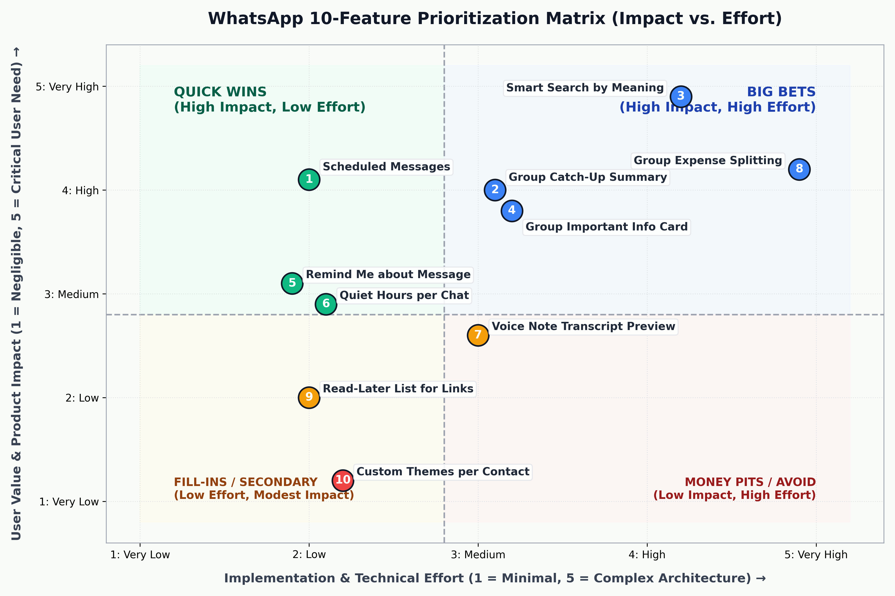
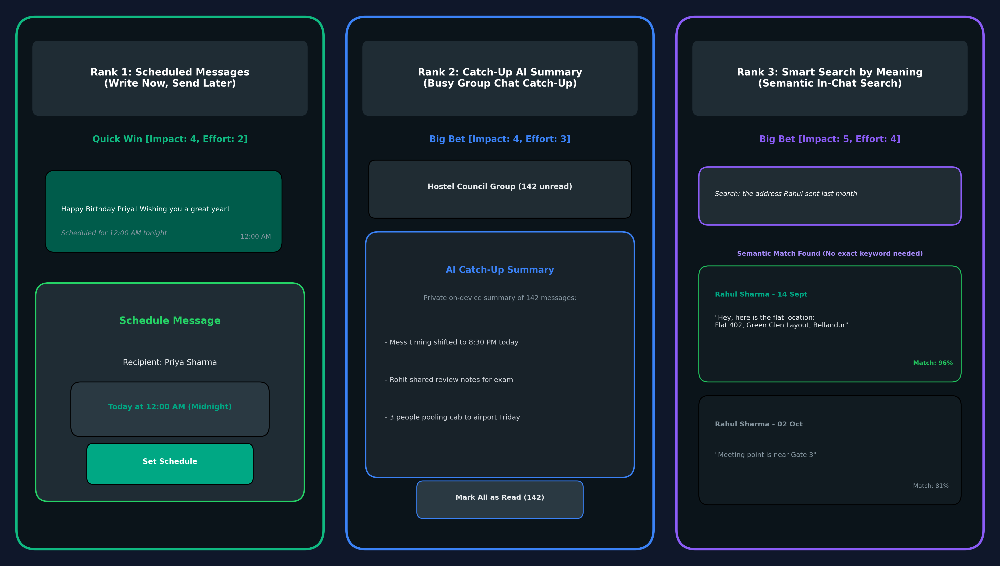
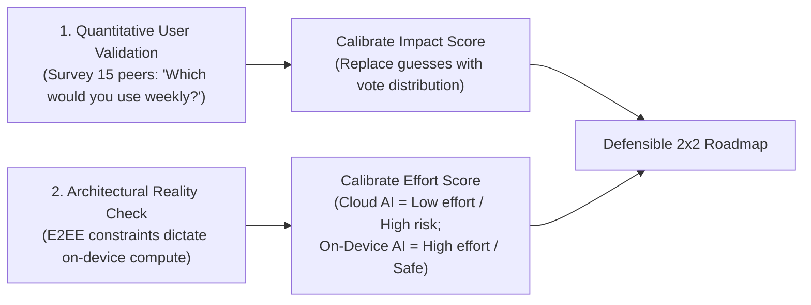

# WhatsApp Feature Prioritization: Impact vs. Effort Framework

### Ranking 10 High-Value Product Opportunities, 2x2 Matrix Mapping, and In-Depth Teardown of the Top 3 Strategic Bets

*A Product Management Case Study: Evaluating feature backlogs for WhatsApp, applying Value vs. Complexity scoring, balancing Quick Wins against Big Bets, and defining execution-ready specs under End-to-End Encryption (E2EE) constraints.*

---

<p align="center">
  
</p>

---

## 📌 Project Overview

| Field | Details |
|---|---|
| **Product Analyzed** | **WhatsApp** (Meta) |
| **Project Type** | Product Management · Backlog Prioritization · Feature Strategy |
| **Role** | Senior Product Manager — Self-Directed Strategy Case Study |
| **Framework Used** | **2x2 Value vs. Complexity (Impact vs. Effort)** Matrix (Scale: 1 = Low, 5 = High) |
| **Key Deliverable** | 10-Feature Ranked Backlog, 2x2 Visual Quadrant Map, and Architectural Teardown of Top 3 Features |
| **Status** | Completed Prioritization · Execution Ready |

---

## 🎯 Executive Summary & Prioritization Philosophy

In hyper-scale consumer products with billions of daily active users like **WhatsApp**, roadmap prioritization is not simply about brainstormed utility. It is about **ruthless sequencing**: identifying high-leverage user value while respecting non-negotiable technical boundaries—most notably **WhatsApp’s strict End-to-End Encryption (E2EE) and on-device compute limits**.

This exercise evaluates **10 distinct product opportunities** across four strategic quadrants:
1. **Quick Wins (High Impact, Low Effort):** Immediate low-hanging fruit to deploy in early sprints (e.g., *Scheduled Messages*).
2. **Big Bets (High Impact, High Effort):** Differentiating technological investments requiring on-device machine learning or architectural refactoring (e.g., *Group Catch-Up Summaries* and *Semantic Search*).
3. **Fill-Ins (Low Effort, Modest Impact):** Secondary polish items for developer downtime (e.g., *Read-Later Links*).
4. **Avoid / Money Pits (Low Impact, High/Medium Effort):** Vanity features that clutter core utility without driving retention (e.g., *Custom Contact Themes*).

---

## 📊 The 10-Feature Scoring & Prioritization Matrix

Scoring methodology: Both **Impact** and **Effort** are evaluated on a calibrated **1 to 5 scale**:
- **Impact (1–5):** Breadth of addressable user base, frequency of use, and depth of emotional/practical relief.
- **Effort (1–5):** Engineering complexity, backend dependencies, mobile UI surface area, and privacy/E2EE compliance overhead.

> **Ranking Rule:** Highest Impact first, then Lowest Effort. Quick Wins with high real-world impact take precedence, followed by high-leverage Big Bets.

| Rank | Feature Concept | User Problem Solved | Impact (1–5) | Effort (1–5) | Strategic Group | Primary Justification |
|:---:|---|---|:---:|:---:|:---:|---|
| **#01** | **Scheduled Messages** *(Write Now, Send Later)* | Users want to send midnight birthday wishes, work reminders, or time-sensitive notes without staying awake or messaging at impolite hours. | **4** | **2** | 🟢 **Quick Win** | High universal demand; cheap implementation via local OS timers and alarm managers. |
| **#02** | **Group Catch-Up AI Summary** | Users returning to busy class, hostel, or family groups face 100+ unread messages and experience FOMO or task paralysis. | **4** | **3** | 🔵 **Big Bet** | Solves group message entropy; requires private on-device LLM distillation. |
| **#03** | **Smart Search by Meaning** | Exact keyword search fails when users recall context (*"the address Rahul sent"*) rather than exact words. | **5** | **4** | 🔵 **Big Bet** | Highest utility on the list; requires local vector embeddings on device. |
| **#04** | **Group "Important Info" Card** | Important dates, addresses, and flight links get buried in chaotic group chatter. | **4** | **3** | 🔵 **Big Bet** | High organizational value; automated heuristic parsing of key entities into a pinned card. |
| **#05** | **"Remind Me About This"** | Users read important tasks or requests on the move and forget to respond later. | **3** | **2** | 🟢 **Quick Win** | Simple message-level snoozing with scheduled local notification triggers. |
| **#06** | **Quiet Hours per Chat** | Non-urgent work or social groups disrupt family dinner or sleep without muting permanently. | **3** | **2** | 🟢 **Quick Win** | Low-effort scheduling layer over WhatsApp's existing mute architecture. |
| **#07** | **Sender Voice Note Transcript** | Senders want to verify audio clarity, background noise, and pronunciation before sending long notes. | **3** | **3** | 🟡 **Fill-In** | Solid quality-of-life feature; utilizes local speech-to-text models before transmission. |
| **#08** | **Group Expense Splitting** | Group trips and hostel dinners require switching out of WhatsApp to Splitwise or calculator apps. | **4** | **5** | 🔵 **Big Bet (Later)** | High utility, but requires massive fintech, UPI ledger, and compliance effort. |
| **#09** | **Read-Later List for Links** | Shared articles, videos, and PDFs get lost in chat streams. | **2** | **2** | 🟡 **Fill-In** | Modest impact; easily handled today via message starring or bookmarks. |
| **#10** | **Custom Chat Themes per Contact** | Cosmetic personalization of chat wallpaper/colors per contact. | **1** | **2** | 🔴 **Avoid for Now** | Minimal retention impact; risks cluttering core messaging UX. |

---

## 📱 Visual UI Mockups: The Top 3 Features

<p align="center">
  
</p>

---

## 🔍 In-Depth Teardown of the Top 3 Prioritized Features

---

### Rank 1: Scheduled Messages (Write Now, Send Later)
> **Strategic Classification:** 🟢 **Top Quick Win (Impact: 4, Effort: 2)**

```text
┌────────────────────────────────────────────────────────┐
│ 🕒 SCHEDULE MESSAGE                                    │
├────────────────────────────────────────────────────────┤
│ Message: "Happy Birthday Priya! Wishing you the best!" │
│ Recipient: Priya Sharma                                │
│                                                        │
│ [ Send Options ]                                       │
│ (●) Midnight Tonight (12:00 AM)                        │
│ ( ) Tomorrow Morning (09:00 AM)                        │
│ ( ) Custom Date & Time: Oct 30, 2026 · 11:45 PM        │
├────────────────────────────────────────────────────────┤
│ [ Cancel ]                         [ Confirm Schedule ]│
└────────────────────────────────────────────────────────┘
```

#### 1. Problem Statement
Users routinely need to send messages at specific times (e.g., midnight birthday greetings, business inquiries during polite working hours, morning medication reminders to parents). Today, users must either:
- Stay awake until midnight.
- Draft messages in external notes apps and set phone alarms to manually send them later.
- Send messages at inappropriate hours, disturbing recipients.

#### 2. The Solution & Scope
A native **"Send Later"** toggle integrated into the standard send button (triggered via long-press on the send arrow). The message is stored in the local SQLite database and scheduled via the native Android `WorkManager` / iOS `BackgroundTasks` framework.

#### 3. Success Metrics & Validation
- **Primary Metric:** % of Weekly Active Users (WAU) who schedule $\ge 1$ message per month.
- **Durable Retention:** 4-week repeat scheduling rate ($\ge 45\%$).
- **Success Volume:** Midnight birthday message delivery success rate ($\ge 99.8\%$).

#### 4. Technical Risks & Edge Cases
- **Timezone Drifts:** If the sender travels across timezones, the scheduled timestamp must be tied to UTC or local recipient time.
- **Device Offline State:** If the sender's device has zero battery or no network at the scheduled moment, queue the message with an explicit status badge: *"Scheduled — will send as soon as connected"*.

---

### Rank 2: Catch-Up AI Summary for Busy Group Chats
> **Strategic Classification:** 🔵 **Top Big Bet #1 (Impact: 4, Effort: 3)**

```text
┌────────────────────────────────────────────────────────┐
│ 👥 HOSTEL COUNCIL GROUP (142 Unread Messages)          │
├────────────────────────────────────────────────────────┤
│ ✨ PRIVATE AI CATCH-UP SUMMARY                         │
│ Generated on-device from messages since yesterday:     │
│                                                        │
│ • Mess timings shifted to 8:30 PM starting tonight.    │
│ • Rohit shared class review notes for Tuesday test.    │
│ • 3 people pooling cab to airport on Friday 5:00 PM.   │
│                                                        │
│ [ Read Full Transcript ]         [ Mark All as Read ]  │
└────────────────────────────────────────────────────────┘
```

#### 1. Problem Statement
Group chats (work teams, hostel committees, family circles, school boards) frequently accumulate hundreds of unread messages during work hours. Users face task paralysis: reading through 200 banter messages takes 15 minutes, but skipping the chat risks missing vital logistical updates.

#### 2. The Solution & Scope
A collapsible **"✨ Catch-Up Summary"** pill displayed at the top of any group chat containing $> 50$ unread messages. 
- Distills the conversation into 3–4 bullet points (Decisions made, deadlines mentioned, action items).
- Automatically collapses once the user scrolls past.

#### 3. Privacy & Architectural Moat (E2EE Compliance)
- **Zero Cloud Transmission:** WhatsApp cannot send plaintext group messages to cloud LLMs without violating its End-to-End Encryption promise.
- **On-Device Small Language Model (SLM):** The summary is generated strictly locally on the user's smartphone using an optimized on-device model (e.g., Llama 3.2 1B / 3B Mobile runtime).

#### 4. Success Metrics & Risks
- **Primary Metric:** % of group backlog clearances initiated via summary tap.
- **Efficiency Metric:** Reduction in average time spent clearing unread backlogs.
- **Critical Risk (Hallucination):** An inaccurate summary of a meeting time or address causes real-world harm. **Mitigation:** Every bullet point includes an inline anchor jump link to the exact source message in chat.

---

### Rank 3: Smart Search by Meaning (Semantic In-Chat Search)
> **Strategic Classification:** 🔵 **Top Big Bet #2 (Impact: 5, Effort: 4)**

```text
┌────────────────────────────────────────────────────────┐
│ 🔍 the address Rahul sent last month                   │
├────────────────────────────────────────────────────────┤
│ ✨ Semantic Match (No exact keyword needed)            │
│                                                        │
│ Rahul Sharma · 14 Sept                                 │
│ "Hey, here is the flat location:                       │
│  Flat 402, Green Glen Layout, Bellandur"               │
│ [ Match Confidence: 96% ]                              │
│                                                        │
│ Rahul Sharma · 02 Oct                                  │
│ "Meeting point is near Gate 3"                         │
│ [ Match Confidence: 81% ]                              │
└────────────────────────────────────────────────────────┘
```

#### 1. Problem Statement
Current search functionality in WhatsApp relies entirely on **exact keyword substring matching**. If a user searches *"address"*, but the friend said *"Here is the flat location: Flat 402..."*, the keyword search returns zero results. Finding critical past information requires tedious manual scrolling through months of chat history.

#### 2. The Solution & Scope
**Semantic Neural Search.** Users search using natural conversational language (*"the recipe mom sent"*, *"wifi password"*, *"flight ticket pdf"*). The search engine understands intent and meaning rather than rigid character sequences.

#### 3. Technical Implementation & Privacy Boundaries
- **On-Device Vector Embeddings:** When a message is decrypted and stored in the local device SQLite database, a lightweight quantized embedding model generates a 256-dimension vector embedding stored in a local on-device vector index (e.g., SQLite-vec / FAISS mobile).
- **Zero Server Exposure:** Embeddings are generated and queried 100% on-device; no chat data or query vectors ever leave the smartphone.

#### 4. Success Metrics
- **Primary Metric:** Search Task Completion Rate (finding the desired message within 1 search query).
- **Speed Metric:** Time-to-find reduction (target: from $75\text{ seconds}$ to $< 10\text{ seconds}$).

---

## 🛠️ Methodological Rigor: How to Defend This Prioritization

When presenting this backlog in a Product Management interview or leadership review, defend your scores using these three principles:



1. **Classmate / Peer Validation Protocol:** Rather than asserting Impact subjectively, poll 15–20 active WhatsApp users: *"Which of these 10 features would you use at least once a week?"* Replace the Impact scores with real normalized vote percentages to make your backlog data-defensible.
2. **The E2EE Multiplier on Effort:** A junior PM might rate "Chat Summary" as a 1-day API call to OpenAI. A senior PM recognizes that WhatsApp **cannot use cloud APIs** due to its privacy promise; therefore, on-device SLM execution elevates the effort from a 1 to a 3.
3. **Guard Against Vanity (Theme Traps):** Custom themes (Rank 10) are frequently requested by casual users, but they consume design and QA bandwidth across hundreds of Android screen densities without driving meaningful engagement or retention.

---

## 📁 Repository Structure

```text
WhatsApp-Feature-Prioritization-Matrix/
├── README.md                          # Full 10-feature prioritization teardown
└── assets/
    ├── prioritization-2x2-matrix.png  # High-res 2x2 Impact vs Effort visual map
    └── top-3-features-ui-mockups.png  # Multi-screen mobile UI mockups
```

---

## 💡 Key PM Takeaways

1. **Quick Wins Build Momentum:** Shipping *Scheduled Messages* delivers immediate delight and trust with low engineering overhead, earning capital for larger engineering investments.
2. **AI Must Respect the Privacy Moat:** Big bets like *Catch-Up Summaries* and *Semantic Search* only work on WhatsApp if they are designed with on-device intelligence that preserves zero-knowledge privacy.
3. **Rank by Impact First, Then Effort:** Prioritizing solely by low effort leads to a backlog of trivial features. True product leadership means taking on high-effort *Big Bets* when the user impact transforms daily life.

---

## Author

**Trishna K**  
Integrated M.Tech in Software Engineering  
*Product Management & Strategic Prioritization Portfolio.*  
GitHub: [@TRISHNA-K](https://github.com/TRISHNA-K) · Email: [trishnakuruppath@gmail.com](mailto:trishnakuruppath@gmail.com)
